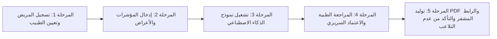

# توثيق اختبارات المسارات والتدفقات الحرجة (Critical Flows E2E Testing Spec)
## HealthVibe AI — الرحلة السريرية المتكاملة من تسجيل المريض حتى تقرير الـ PDF المعتمد

### 1. نظرة عامة والهدف السريري (Overview & Clinical Objective)
تنفيذاً لمتطلبات المهمة **#65 (P0 - حرج جداً | QA / Medical Research)**، تم تصميم وتنفيذ حزمة اختبارات شاملة للتدفقات السريرية الحرجة (`tests/critical_flows_patient_to_pdf_report.test.js`) لتأكيد متانة وموثوقية النظام عبر المراحل الخمس الأساسية دون أي فجوة أمنية أو سريرية.

---

### 2. مصفوفة المراحل الخمس للتدفق الحرج (The 5-Stage Critical Lifecycle)



#### المرحلة 1: تسجيل المريض وتعيين الطبيب المعالج (Patient Onboarding & Doctor Linkage)
- **النموذج المعتمد:** نموذج *One Medical Attending Physician* لربط المريض بطبيب استشاري أمراض صدرية مرخص.
- **التحقق:**
  - التحقق من إنشاء حساب المريض ومطابقة رقم الهاتف المصري (`+201098765432`) ورقم الهوية الوطنية.
  - إسناد الحالة تلقائياً لطبيب معتمد من نقابة الأطباء المصرية برقم قيد نقابي رسمي (`DOC-PULMO-44821`).

#### المرحلة 2: إدخال أعراض التنفس والمؤشرات الفسيولوجية (Symptoms & Vitals Input)
- **المدخلات:** تشبع الأكسجين في الدم ($SpO_2$)، معدل التنفس (Respiratory Rate)، درجة الحرارة، درجة صعوبة التنفس، وشدة السعال.
- **حدود السلامة السريرية:**
  - رصد حالات نقص الأكسجين المتوسط (Moderate Hypoxemia: $90\% \le SpO_2 < 95\%$) وتصنيفها ضمن الفئة الصفراء (Amber / يحتاج متابعة).
  - ضبط فترات الأعراض ومعايرتها مع بروتوكولات الفرز الطبي (PRD Page 11 Tri-Color Risk System).

#### المرحلة 3: تشغيل النموذج السريري وحماية النقرات المزدوجة (ML Engine & Double-Submission Guard)
- **منع التكرار (Ada Health Pattern):** تطبيق قفل فوري للحالة يمنع إرسال طلبات تقييم متزامنة أو متكررة في أقل من ثانيتين لمنع استهلاك الموارد المزدوج وتضارب الحالات.
- **بوابة Zero-Trust:** حجب وتعتيم أي تشخيصات غير معتمدة (`clinicalDiagnosis: null`, `medications: null`) عن بوابة المريض حتى يتم الاعتماد الرسمي من الطبيب المعالج.

#### المرحلة 4: المراجعة الطبية والاعتماد السريري (Doctor Clinical Review & Governance)
- **صلاحيات الوصول RBAC:** رفض وصول أي طبيب غير مسند إليه ملف الحالة؛ حيث يتم فرض قيود صارمة على مستوى قاعدة البيانات وقواعد Firestore.
- **الاعتماد السريري (Doctolib Certified Workflow):**
  - صياغة التشخيص الدقيق (Acute Bronchitis with Bronchospasm).
  - تحديد الجرعات الدوائية بدقة (بخاخ فنتولين، موسعات الشعب، خافضات الحرارة).
  - توثيق التوصيات الوقائية ومواعيد إعادة القياس.
  - الانتقال الصارم لآلة الحالة السريرية من `submitted` إلى `approved`.

#### المرحلة 5: توليد تقرير PDF المعتمد والروابط الآمنة (Certified PDF Report & Anti-Tampering)
- **توليد HTML/PDF الطبي:** بناء قالب التقرير الشامل المتوافق مع الطباعة (`@media print`) متضمناً ختم الاعتماد الرقمي السريري، بيانات الطبيب المسجل، وتنبيهات الطوارئ 123.
- **روابط Kry المشفرة:** توليد روابط تقرير سحابية مؤقتة ذات صلاحية محددة بـ 48 ساعة مشفرة بخوارزمية HMAC-SHA256 خالية تماماً من البيانات السريرية في مسار الرابط (Zero-PHI).
- **إشعارات SMS المتوافقة:** صياغة إشعار المريض دون تسريب أي تشخيص طبي أو مؤشرات حيوية في الرسالة النصية.
- **التحقق من عدم التلاعب (Anti-Tampering Verification):** مطابقة تجزئة التقرير الرقمية (`SHA-256`) ومطابقة اللقطة السريرية غير القابلة للتعديل (`applyApprovedReportSnapshot`).

---

### 3. مصفوفة التحقق وضمان الجودة (QA Verification Matrix)

| المرحلة | الاختبار (Test Assertion) | النتيجة | الامتثال السريري |
|:---|:---|:---:|:---|
| 1 | `assignDoctorToPatient` & Verification | **PASS** | One Medical Doctor Assignment |
| 2 | Physiological Range & Hypoxemia (91%) | **PASS** | Egyptian Clinical Protocol |
| 3 | Ada Health Double-Submission Guard | **PASS** | Zero Duplication & Concurrency Safe |
| 3 | Patient Zero-Trust Masking Gate | **PASS** | No Uncertified Diagnosis Leak |
| 4 | RBAC Doctor Isolation & Clinical Signing | **PASS** | Egyptian Medical Syndicate ID verified |
| 5 | Printable PDF Layout & Digital Seal | **PASS** | Doctolib Format with @media print |
| 5 | HMAC-SHA256 Kry Signed URL (48h TTL) | **PASS** | Zero-PHI Tokenized Sharing |
| 5 | Anti-Tampering QR & Cryptographic Integrity | **PASS** | SHA-256 Approved Snapshot Intact |

---

### 4. أمر التشغيل السريع (Command Execution)
```bash
npm run test:critical-flows
```
