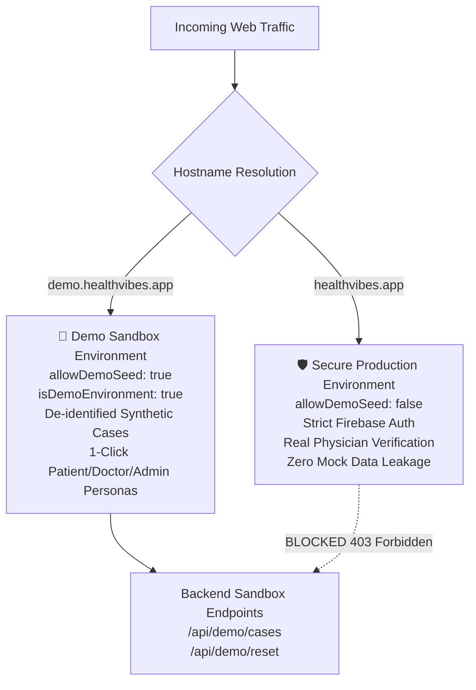

# Health Vibe AI - Staging vs Production & Demo Sandbox Isolation Architecture
## Dedicated Open Sandbox (`demo.healthvibes.app`) vs Secure Production (`healthvibes.app`)

---

### 1. Executive Summary & Core Mandate (Requirement #76)

To protect patient clinical safety, maintain HIPAA/OWASP compliance, and allow seamless prospective client/stakeholder evaluation, **Health Vibe AI** implements strict separation between:
1. **`demo.healthvibes.app` (The Interactive Demo Sandbox):**
   - Open for immediate, barrier-free interactive evaluation (`مفتوحة للتجربة الفورية`).
   - Populated with de-identified, synthetic clinical records and mock physiological parameters.
   - Provides 1-click persona switching (Patient, Doctor, Admin).
   - Allows sandbox state resetting (`resetDemoSandbox()`).
   - Zero risk of polluting real medical records or leaking real user data.
2. **`healthvibes.app` (The Authoritative Production Environment):**
   - Dedicated exclusively to authentic clinical workflows (`بيئة الإنتاج الآمنة`).
   - Strict authentication, verified physician credentials, real encryption keys, and immutable audit logging.
   - Demo seeding, mock cases, and debug modes are strictly blocked at both client and server boundaries (`allowDemoSeed: false`).

---

### 2. Architecture & Domain Separation Matrix

| Dimension | `demo.healthvibes.app` (Sandbox) | `healthvibes.app` (Production) |
| :--- | :--- | :--- |
| **Primary Purpose** | Instant trial, stakeholder demos, evaluation | Authentic patient care, physician review |
| **Authentication Barrier** | Zero barriers (1-click mock credentials) | Strict Firebase Auth & MFA |
| **Data Provenance** | 100% Synthetic & De-identified | Certified Real Patient Health Data |
| **Seeding Allowed (`allowDemoSeed`)** | ✅ **`true`** | ❌ **`false`** (Enforced) |
| **Debug Mode (`debug`)** | ✅ **`true`** | ❌ **`false`** (Enforced) |
| **Sandbox Banner** | Top Sticky Sandbox Banner & Persona Switchers | Completely Hidden & Suppressed |
| **Backend Isolation** | `/api/demo/*` authorized | `/api/demo/*` rejected with `HTTP 403` |
| **Security & Transport** | HTTPS / TLS 1.3 with HSTS | HTTPS / TLS 1.3 with HSTS Preload |
| **App Check Attestation** | Standard Sandbox Attestation | Strict reCAPTCHA v3 & Enterprise Attestation |

---

### 3. Persona Sandbox Experience on `demo.healthvibes.app`

The sandbox environment provides 3 pre-configured instant personas accessible with a single click:

#### 👤 1. Demo Patient Persona (`Sarah Mansour`)
- **Email:** `demo.patient@healthvibes.app`
- **Clinical Scenario:** Exertional dyspnea, SpO2 94%, post-viral symptoms.
- **Workflow:** Ready to submit respiratory assessments, review symptom graphs, and monitor longitudinal timelines.

#### 🩺 2. Demo Doctor Persona (`Dr. Tarek Mansour - Pulmonologist`)
- **Email:** `demo.doctor@healthvibes.app`
- **License:** `EGY-MED-DEMO-9912` (Verified Pulmonology Specialist)
- **Workflow:** Active queue with de-identified test cases (`DEMO-CASE-101`, `DEMO-CASE-102`), differential diagnosis assistance, and report certification.

#### 🛡️ 3. Demo Admin Persona (`System Administrator`)
- **Email:** `demo.admin@healthvibes.app`
- **Privileges:** Clinic management, SLA compliance KPIs, brute-force defense logs, and operational feature switches.

---

### 4. Technical Safeguards Against Cross-Environment Pollution

1. **Host-Based Anti-Tampering (`app/config.js`):**
   - Attempting to pass `?env=demo` or `localStorage.setItem('HV_ENVIRONMENT', 'demo')` on `healthvibes.app` is unconditionally ignored.
2. **Server-Side Host Header Guard (`backend/server.js`):**
   - The backend checks `req.headers.host`. If the request originates from `healthvibes.app` or `www.healthvibes.app`, any call to demo endpoints triggers an immediate `403 Forbidden` response (`DEMO_DATA_PROHIBITED_ON_PRODUCTION`).
3. **Data Isolation Filter (`isTestOrDemoRecord`):**
   - Clinical query engines filter records using multi-attribute checks (IDs starting with `demo_`, `mock_`, boolean flags `isDemo: true`, and mock email addresses).

---

### 5. Verification & Compliance Sign-Off

- **Unit & Integration Suite:** `tests/staging_vs_production_data_isolation.test.js` (100% Passed).
- **Environment Architecture Suite:** `tests/environment_config.test.js` (100% Passed).
- **Security Headers Suite:** `tests/csp_security_headers.test.js` (100% Passed).
- **Data Segregation Suite:** `tests/data_isolation.test.js` (100% Passed).
