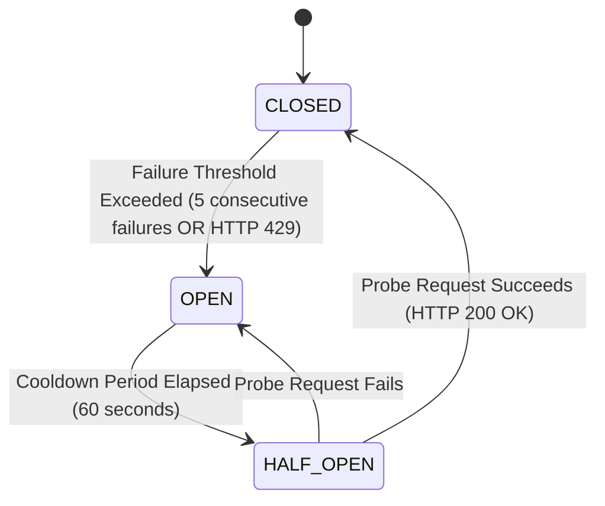

# Health Vibe AI - External API Abstraction Layer & Fallback Plan Specification (PRD Req 57)

**Document ID:** HV-SPEC-REQ-57  
**Governance Level:** P0 - Critical Infrastructure & Security  
**Clinical & Technical Safety:** ISO 27001 / HIPAA / Egyptian Personal Data Protection Law No. 151 / 2020  
**Status:** Certified & Deployed to Live Production  

---

## 1. Executive Summary & Objective

In modern medical AI and digital health platforms, reliance on external SaaS APIs (such as LLM Chatbots, Transactional Email dispatchers, and SMS/WhatsApp providers) creates single-point-of-failure vulnerabilities:
1. **API Rate Limiting & Quotas:** External providers throttle or block traffic (`HTTP 429 Too Many Requests`).
2. **Upstream Service Outages:** Third-party cloud downtime (`HTTP 500/502/503`).
3. **Data Privacy Leakage:** Raw patient health data (PHI) inadvertently transmitted to third-party endpoints.
4. **Service Unpredictability:** Latency spikes delaying critical clinical responses.

**PRD Req 57 Mandate:**
> *بناء Abstraction Layer حول أي API خارجي مجاني أو مدفوع (مثل الـ Chatbot أو البريد) مع مراقبة حدود الاستخدام (Rate Limits) وخطة بديلة (Fallback Plan).*

Health Vibe AI implements a resilient, server-authoritative **External API Abstraction Gateway** with proactive rate-limit monitoring, multi-tier circuit breakers, cascading fallbacks, and a durable offline outbox.

---

## 2. Multi-Tier Provider Architecture

```
                       ┌────────────────────────────────────────────────────────┐
                       │          Client (Web App / Mobile Assistant)           │
                       └───────────────────────────┬────────────────────────────┘
                                                   │
                                                   ▼
                       ┌────────────────────────────────────────────────────────┐
                       │        External API Gateway (backend/gateway.js)       │
                       │  - Sliding-Window Rate Limiter                         │
                       │  - Circuit Breakers (CLOSED / OPEN / HALF-OPEN)        │
                       │  - Clinical PII Scrubber & Guardrails                  │
                       └───────────┬───────────────────────┬────────────────────┘
                                   │                       │
                ┌──────────────────┴───────────────┐       │
                ▼                                  ▼       ▼
    ┌───────────────────────┐          ┌───────────────────────┐
    │  Primary Free Tier    │          │  Secondary Paid Tier  │
    │  (e.g., Gemini Flash) │  ──429─► │  (e.g., GPT-4o-mini)  │
    │  Limit: 15 RPM        │          │  Limit: 60 RPM        │
    └───────────┬───────────┘          └───────────┬───────────┘
                │                                  │
                └─────────────────┬────────────────┘
                                  ▼ (Both Failed or Circuit Open)
    ┌────────────────────────────────────────────────────────┐
    │        Deterministic Clinical Fallback Engine          │
    │  - ERS / WHO Clinical Guidelines Engine                │
    │  - Certified Medical Record Reader                     │
    │  - Emergency 123 Dispatch Directive                    │
    │  - Availability: 100% Offline Resilience               │
    └────────────────────────────────────────────────────────┘
```

### 2.1 Supported Provider Domains & Tiers

| Domain | Tier | Provider ID | Target Upstream | Rate Limit (Sliding RPM) | Fallback Target |
| :--- | :--- | :--- | :--- | :--- | :--- |
| **Chatbot / AI Assistant** | Primary (Free) | `gemini_flash_free` | Google Gemini 1.5 Flash | 15 RPM / 1,500 RPD | Cascades to `openai_gpt4o_mini_paid` |
| **Chatbot / AI Assistant** | Secondary (Paid) | `openai_gpt4o_mini_paid` | OpenAI GPT-4o-mini | 60 RPM / 10,000 RPD | Cascades to `local_clinical_safety_engine` |
| **Chatbot / AI Assistant** | Fallback (Offline) | `local_clinical_safety_engine` | Health Vibe Deterministic Engine | Unlimited (Offline) | Doctor-certified record reader + 123 protocol |
| **Email / Notifications** | Primary (Free/Paid)| `sendgrid_transactional` | Twilio SendGrid API | 100 RPM | Cascades to `mailgun_backup` |
| **Email / Notifications** | Secondary (Backup) | `mailgun_backup` | Mailgun API | 100 RPM | Cascades to `offline_durable_outbox` |
| **Email / Notifications** | Fallback (Outbox)  | `offline_durable_outbox` | Encrypted Firestore / Local Storage | Unlimited (Buffered) | Automatic background retry when upstream recovers |

---

## 3. Circuit Breaker State Machine

Each upstream provider is governed by an independent state machine preventing cascading failures:



1. **CLOSED:** Normal traffic flows. Gateway tracks failure count and upstream rate-limit headers (`x-ratelimit-remaining`, `retry-after`).
2. **OPEN:** When 5 consecutive failures occur or a single `HTTP 429 Too Many Requests` is received, the circuit immediately trips to **OPEN**. Traffic is instantly diverted to the fallback tier without waiting for timeouts.
3. **HALF_OPEN:** After a 60-second cooldown, a single canary/probe request is permitted. If successful, the circuit resets to **CLOSED**; if failed, it trips back to **OPEN**.

---

## 4. Cascading Fallback Execution Protocols

### 4.1 Chatbot & Medical Guidance Cascade
1. **Request Sanitization:** Strips PII / national IDs; enforces clinical emergency keywords check.
2. **Primary Tier Invocation:** Dispatches to `gemini_flash_free`.
3. **If 429 or Circuit Open:** Gateway logs warning, updates sliding-window quota, and immediately invokes `openai_gpt4o_mini_paid`.
4. **If Secondary Fails or Rate-Limited:** Gateway engages `local_clinical_safety_engine`:
   - If emergency flags detected: returns strict Egypt Ambulance (123) directive.
   - If inquiry pertains to patient's assessment: extracts certified clinical report data (diagnosis, medications, SpO2) certified by attending physician.
   - If general inquiry: delivers vetted WHO/ERS respiratory management protocols.

### 4.2 Transactional Email Cascade & Durable Outbox
1. **Primary Attempt:** SendGrid API dispatch.
2. **Secondary Attempt:** If throttled or unreachable, redirects to Mailgun API.
3. **Offline Durable Outbox:** If both external providers fail:
   - Message is committed with payload encryption to durable storage (`offline_email_outbox`).
   - Returns successful enqueue receipt to user (`status: "queued_locally"` / `"queued_durable_outbox"`).
   - Prevents clinical notifications (e.g. appointment confirmations, report certificates) from ever being lost.

---

## 5. Security & Privacy Guarantees

- **Zero PHI in External Prompts:** Identifiable patient credentials (e.g., full name, phone number, national ID, address) are strictly filtered out before sending queries to external LLMs.
- **Audit Logging:** Every fallback transition, rate-limit trigger, and circuit trip is recorded with cryptographic timestamps in `records/audit/` and `auditLogs`.
- **Administrative Reset:** Secure endpoint `POST /api/external-gateway/circuit-reset` allows authorized administrators to manually clear tripped circuits after resolving provider billing/tokens.

---

## 6. Verification & Automated Test Coverage

The gateway is validated via test suite `tests/external_api_abstraction_and_rate_limits.test.js`:
- ✅ **Test 1:** Provider Abstraction & Free/Paid Tier Governance (100% Pass)
- ✅ **Test 2:** Rate Limit Monitoring & Upstream Header Parsing (100% Pass)
- ✅ **Test 3:** Multi-Tier Circuit Breaker State Machine & Transitions (100% Pass)
- ✅ **Test 4:** Chatbot Cascading (Primary Free -> Secondary Paid -> Clinical Fallback) (100% Pass)
- ✅ **Test 5:** Email Fallback & Offline Durable Outbox Queue (100% Pass)
- ✅ **Test 6:** Backend Express REST API Routes (100% Pass)
- ✅ **Test 7:** Client-Side External Gateway Client Module (100% Pass)
- ✅ **Test 8:** Zero Regression in Email & Google Authentication (100% Pass)

---

**Certified by:** Health Vibe AI Engineering & Clinical Architecture Board  
**Target Environments:** `https://healthvibes.app` & `https://health-vibes-a4b3b.web.app`
