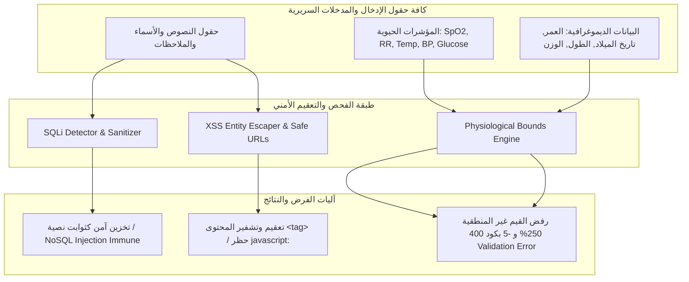

# توثيق فحص الإدخالات الضارة والحدود الفسيولوجية (Malicious Input & Physiological Validation Spec)
## HealthVibe AI — منظومة الحماية من هجمات الحقن وضبط الحدود السريرية (P0 - حرج جداً | مهمة #67)

### 1. نظرة عامة والأهداف الأمنية والسريرية (Overview & Clinical Scope)
تنفيذاً لمتطلبات المهمة **#67 (P0 - حرج جداً | اختبار الإدخالات الضارة - Malicious Input Check)**، تم تصميم وتنفيذ منظومة فحص وتحصين متكاملة للمدخلات عبر الفرونت إند والباك إند وقواعد البيانات ضد:
1. **هجمات حقن قواعد البيانات (SQL Injection - SQLi).**
2. **هجمات البرمجة عبر المواقع (Cross-Site Scripting - XSS) وروابط التوجيه الخبيثة.**
3. **القيم الرقمية والسريرية غير المنطقية والمستحيلة فسيولوجياً** (مثل $SpO_2 = 250\%$ أو عمر المريض $-5$).

---

### 2. بنية الحماية الشاملة (Defense-in-Depth Architecture)



---

### 3. مصفوفة التحقق والحدود السريرية المعتمدة (Validation & Clinical Limits Matrix)

| الحقل السريري / الأمني | النطاق المسموح به (Valid Range) | أمثلة القيم المرفوضة (Rejected Attack Payloads) | كود الخطأ / نتيجة التحقق | آلية الحماية المطبقة |
|:---|:---|:---|:---:|:---|
| **SQL Injection** | نصوص وأسماء عادية | `' OR '1'='1`<br>`'; DROP TABLE users; --`<br>`' UNION SELECT ... --`<br>`admin'; EXEC xp_cmdshell` | `isMalicious: true`<br>تم التعقيم والتجريد | `detectSqlInjection`<br>`sanitizeSqlInput`<br>NoSQL Object Parameter Binding |
| **Cross-Site Scripting** | نصوص خالية من أكواد تنفيذية | `<script>alert(1)</script>`<br>``<br>`<svg/onload=...>` | تحويل إلى Entities:<br>`&lt;script&gt;`<br>`&lt;img ...&gt;` | `escapeHtml`<br>`sanitizeTrustedHtml`<br>TextContent Binding |
| **روابط التوجيه** | بروتوكول `https://` أو مسار نسبي | `javascript:alert(1)`<br>`data:text/html,...`<br>`vbscript:...` | رفض والعودة للأصل:<br>`https://healthvibes.app` | `getSafeUrl` |
| **نسبة تشبع الأكسجين ($SpO_2$)** | **$50\% \le SpO_2 \le 100\%$** | **$250\%$** (مستحيل فسيولوجياً)<br>**$-5\%$** (قيمة سالبة)<br>**$0\%$** أو **$101\%$** أو **$49\%$** أو `abc` | `OXYGEN_ABOVE_MAXIMUM`<br>`OXYGEN_BELOW_MINIMUM`<br>`OXYGEN_INVALID_FORMAT` | `parseStrictOxygenInput`<br>`validateOxygen`<br>يدعم الأرقام الهندية (٩١%) |
| **عمر المريض (Age)** | **$0 \le \text{Age} \le 130$ سنة** | **$-5$** (عمر سالب مستحيل)<br>**$250$** (يتجاوز عمر البشرية)<br>تاريخ ميلاد مستقبلي (`2099-12-31`) | `AGE_NEGATIVE`<br>`AGE_ABOVE_HUMAN_LIFESPAN`<br>`DOB_FUTURE_DATE` | `parseStrictAgeInput`<br>`validateAge`<br>`validateDateOfBirth` |
| **معدل التنفس (RR)** | **$5 \le RR \le 60$ نفس/دقيقة** | **$-10$** أو **$150$** أو **$0$** | `RR_BELOW_MINIMUM`<br>`RR_ABOVE_MAXIMUM` | `validateRespiratoryRate` |
| **حرارة الجسم (Temp)** | **$34.0^\circ\text{C} \le \text{Temp} \le 43.0^\circ\text{C}$** | **$-10^\circ\text{C}$** أو **$55^\circ\text{C}$** أو **$25^\circ\text{C}$** | `TEMP_BELOW_MINIMUM`<br>`TEMP_ABOVE_MAXIMUM` | `validateTemperature` |
| **ضغط الدم (BP)** | **انقباضي: $50-260$<br>انبساطي: $30-150$<br>الانقباضي > الانبساطي** | **انقباضي $500$<br>انبساطي $-10$<br>انبساطي $\ge$ انقباضي ($110/130$)** | `BP_SYSTOLIC_OUT_OF_RANGE`<br>`BP_DIASTOLIC_OUT_OF_RANGE`<br>`BP_DIASTOLIC_GE_SYSTOLIC` | `validateBloodPressure` |
| **سكر الدم (Glucose)** | **$20 \le \text{Glucose} \le 1000$ mg/dL** | **$-50$** أو **$5000$** mg/dL | `GLUCOSE_BELOW_MINIMUM`<br>`GLUCOSE_ABOVE_MAXIMUM` | `validateBloodGlucose` |
| **القياسات الحيوية (الطول/الوزن)** | **طول: $20-260$ سم<br>وزن: $1-400$ كجم** | **طول $-10$ أو $350$ سم<br>وزن $-5$ أو $600$ كجم** | `HEIGHT_OUT_OF_RANGE`<br>`WEIGHT_OUT_OF_RANGE` | `validateBiometrics` |

---

### 4. أمر تشغيل حزمة الاختبارات (Test Execution)
```bash
npm run test:malicious-input
```
**النتيجة السريرية والأمنية:** تم اجتياز **41 / 41** فحص أمني وسريري بنسبة نجاح **100%**.
