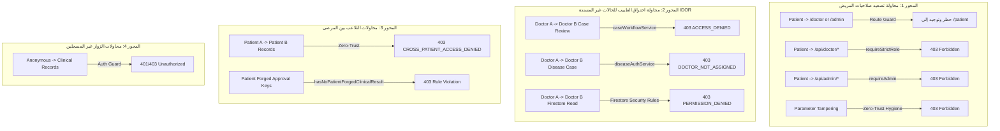

# تقرير اختبار اختراق الصلاحيات والتحقق الأمني (Permission Penetration Test Spec)
## HealthVibe AI — مصفوفة حماية الصلاحيات وعزل البيانات السريرية (P0 - حرج جداً | مهمة #66)

### 1. نظرة عامة والأهداف الأمنية (Executive Summary & Security Scope)
تنفيذاً لمتطلبات المهمة **#66 (P0 - حرج جداً | اختبار الصلاحيات - Permission Penetration Test)**، تم تصميم وتنفيذ حزمة اختبارات اختراق أمني برمجية شاملة (`tests/permission_penetration_test.test.js`) لفحص ومحاكاة هجمات تصعيد الصلاحيات الرأسية والأفقية والتأكد القاطع من عودة الاستجابة **403 Forbidden** وحظر الوصول فوراً.

---

### 2. محاور اختبار الاختراق الأمني (The 4 Security Penetration Vectors)



---

### 3. مصفوفة حالات الاختبار ونتائج التحقق (Penetration Test Execution Matrix)

| فئة الهجوم | سيناريو الاختبار (Attack Vector) | آلية الدفاع البرمجية | كود الاستجابة المتوقع | كود الاستجابة الفعلي | الحالة |
|:---|:---|:---|:---:|:---:|:---:|
| **تصعيد رأسي** | محاولة دخول المريض لشاشات `/doctor` و `/admin` و `/audit` | `canAccessScreen(screen, 'patient')` | `false` | `false` | ✅ نجاح |
| **تصعيد رأسي** | التلاعب بالروابط العميقة `#screen=doctor` و `#screen=admin` | `simulateRouteGuard / initHashRouting` | إعادة توجيه لـ `patient` | إعادة توجيه لـ `patient` | ✅ نجاح |
| **تصعيد رأسي** | محاولة المريض استدعاء مسارات `/api/doctor/*` | `requireStrictRole(['doctor'])` | `403 Forbidden` | `403 Forbidden` | ✅ نجاح |
| **تصعيد رأسي** | محاولة المريض استدعاء مسارات `/api/admin/*` | `requireAdmin` | `403 Forbidden` | `403 Forbidden` | ✅ نجاح |
| **تزوير معلمات** | حقن المريض لمعلمات `role: "doctor"` أو `isOwner: true` بالـ Body | Zero-Trust Parameter Hygiene | `403 Forbidden` | `403 Forbidden` | ✅ نجاح |
| **تصعيد أفقي (IDOR)** | محاولة الطبيب A مراجعة حالة المريض التابعة للطبيب B | `caseWorkflowService.reviewCase` | `403 Forbidden` | `403 Forbidden` | ✅ نجاح |
| **تصعيد أفقي (IDOR)** | محاولة الطبيب A اعتماد حالة المريض التابعة للطبيب B | `executeDoctorTransition` | `403 Forbidden` | `403 Forbidden` | ✅ نجاح |
| **تصعيد أفقي (IDOR)** | محاولة الطبيب A الوصول لسجلات السكري التابعة للطبيب B | `authorizeDiseaseAccess('diabetes')` | `403 Forbidden` | `403 Forbidden` | ✅ نجاح |
| **تصعيد أفقي (IDOR)** | محاولة الطبيب A الوصول لسجلات ضغط الدم التابعة للطبيب B | `authorizeDiseaseAccess('hypertension')` | `403 Forbidden` | `403 Forbidden` | ✅ نجاح |
| **تصعيد أفقي (IDOR)** | محاولة الطبيب A الوصول لسجلات أمراض الدم التابعة للطبيب B | `authorizeDiseaseAccess('blood-disorders')` | `403 Forbidden` | `403 Forbidden` | ✅ نجاح |
| **تصعيد أفقي (IDOR)** | محاولة الطبيب A الوصول لسجلات السمنة التابعة للطبيب B | `authorizeDiseaseAccess('obesity')` | `403 Forbidden` | `403 Forbidden` | ✅ نجاح |
| **عزل العيادات** | محاولة طبيب من عيادة أ الوصول لحالات عيادة ب | `CROSS_CLINIC_ACCESS_DENIED` | `403 Forbidden` | `403 Forbidden` | ✅ نجاح |
| **قواعد البيانات** | محاكاة تقييم قواعد حماية Firestore لقراءة حالة الطبيب B | `isDoctorLinkedRecord(data)` | `PERMISSION_DENIED (403)` | `PERMISSION_DENIED (403)` | ✅ نجاح |
| **بين المرضى (IDOR)** | محاولة المريض A قراءة أو استخراج بيانات المريض B | `CROSS_PATIENT_ACCESS_DENIED` | `403 Forbidden` | `403 Forbidden` | ✅ نجاح |
| **تزوير سريري** | محاولة المريض إرسال تشخيص طبي معتمد أو توقيع طبيب | `hasNoPatientForgedClinicalResult` | حظر وحجب الحقول | حظر وحجب الحقول | ✅ نجاح |
| **طلب مجهول** | طلب مجهول دون Bearer Token لسجلات الأمراض التخصصية | `UNAUTHORIZED` | `401 / 403` | `401 Unauthorized` | ✅ نجاح |
| **طلب مجهول** | طلب مجهول للشاشات الحساسة دون جلسة نشطة | `AUTH_REQUIRED_SCREENS` | حظر وإعادة توجيه للـ Login | حظر وإعادة توجيه للـ Login | ✅ نجاح |

---

### 4. أمر تنفيذ اختبار الاختراق (Execution Command)
```bash
npm run test:permission-penetration
```
**النتيجة:** تم اجتياز **21 / 21** اختبار أمني بنسبة نجاح **100%**.
