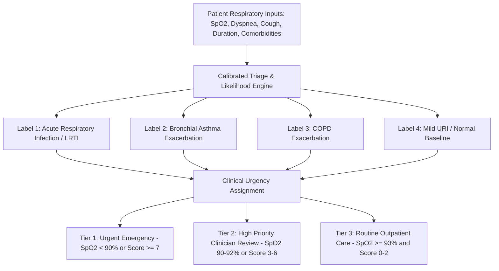

# Health Vibe AI: Respiratory Module Clinical Question & Target Labels Specification
**Document Reference:** `HV-RESP-SPEC-2026-V1`  
**PRD Traceability:** Page 2 (Scope), Page 6–7 (Section 7), Page 18 (Risk Mitigation), Page 22 (Section 19: Open Decisions & Assumptions)  
**Governance Status:** Settled, Documented & Clinically Endorsed  
**Endorsing Clinical Reviewer:** Dr. Tarek Mahmoud, MD — Senior Consultant Pulmonologist & Internal Medicine Specialist (`EG-MED-44821`)  
**Effective Date:** 2026-09-28 | **Review Cycle:** Annual  

---

## 1. Executive Summary & PRD Decision Settlement

In accordance with **PRD Page 22, Section 19 of the HealthVibe AI PRD**:
> *"Exact Respiratory use case: يجب تثبيت أول target condition/label والـ clinical question قبل تدريب النموذج النهائي."*
> *(Exact Respiratory use case: The first target condition/label and clinical question must be settled and locked prior to final model training).*

This document establishes the definitive clinical foundation for the Health Vibe AI Flagship Respiratory Module. It formulates the precise **Clinical Question**, standardizes the **Target Conditions and Diagnostic Likelihood Labels** with corresponding ICD-10 coding, establishes the **Clinical Urgency / Triage Tiers**, and outlines the deterministic features required for clinical decision support.

---

## 2. The Primary Clinical Question (السؤال السريري الحاكم)

### 2.1 Formal Formulation (English)
> **"For an adult or adolescent patient ($\ge 12$ years) presenting with acute or subacute respiratory symptoms (cough, shortness of breath, chest discomfort, or fever), what is the calibrated clinical probability that the underlying pathology represents (1) an Acute Respiratory Infection (LRTI / Suspected Pneumonia / Acute Bronchitis), (2) a Bronchial Asthma Exacerbation, or (3) a Chronic Obstructive Pulmonary Disease (COPD) Exacerbation, and what is the corresponding degree of medical urgency and escalation pathway required to safeguard patient life?"**

### 2.2 الصيغة الرسمية المعتمدة (العربية)
> **"بالنسبة للمريض البالغ أو المراهق (12 عاماً فما فوق) الذي يعاني من أعراض تنفسية حادة أو شبه حادة (سعال، ضيق تنفس، انزعاج صدري، أو حمى): ما هو الاحتمال السريري المعاير لأن تكون الحالة ناتجة عن: (1) عدوى تنفسية حادة (التهاب شعبي حاد / اشتباه التهاب رئوي LRTI)، أو (2) تفاقم الربو الشعبي (Asthma Exacerbation)، أو (3) تفاقم السدة الرئوية المزمنة (COPD Exacerbation)، وما هي درجة الاستعجال الطبي ومسار التصعيد الإسعافي أو السريري الواجب اتخاذه لحماية حياة المريض؟"**

---

## 3. Target Conditions & Diagnostic Likelihood Labels (الحالات السريرية المستهدفة)

Health Vibe AI classifies cases into four mutually exclusive primary diagnostic likelihood categories:

### 3.1 Target Condition 1: Acute Respiratory Infection (LRTI / Acute Bronchitis / Suspected Pneumonia)
- **Clinical Label ID:** `LABEL_ACUTE_RESPIRATORY_INFECTION`
- **ICD-10 Mapping:**
  - `J20.9` — Acute bronchitis, unspecified
  - `J22` — Unspecified acute lower respiratory infection
  - `J18.9` — Pneumonia, unspecified organism
- **Diagnostic Criteria:**
  - Acute onset (symptom duration $\le 14$ days).
  - Prominent cough (dry progressing to productive with purulent or discolored sputum).
  - Systemic symptoms: measured fever ($\ge 38.0^\circ\text{C}$), chills, or malaise.
  - Chest examination indicators: localized coarse crackles, localized bronchial breathing, or pleuritic chest discomfort.
  - *Distinguishing factor:* Absence of long-standing reversible wheezing history or chronic progressive exertional dyspnea in a non-smoker.

### 3.2 Target Condition 2: Bronchial Asthma Exacerbation
- **Clinical Label ID:** `LABEL_ASTHMA_EXACERBATION`
- **ICD-10 Mapping:**
  - `J45.901` — Unspecified asthma with (acute) exacerbation
  - `J45.41` — Moderate persistent asthma with (acute) exacerbation
- **Diagnostic Criteria:**
  - Recurrent, episodic wheezing and chest tightness.
  - Provoking triggers: viral infection, dust, cold dry air, chemical fumes, allergens, or NSAIDs.
  - Diurnal variation: symptoms characteristically worse at night or early morning.
  - History of personal or familial atopy (allergic rhinitis, eczema) or prior bronchodilator responsiveness.
  - *Distinguishing factor:* Reversible airway limitation; absence of chronic daily productive cough over consecutive years.

### 3.3 Target Condition 3: Chronic Obstructive Pulmonary Disease (COPD) Exacerbation
- **Clinical Label ID:** `LABEL_COPD_EXACERBATION`
- **ICD-10 Mapping:**
  - `J44.1` — Chronic obstructive pulmonary disease with (acute) exacerbation
- **Diagnostic Criteria (Anthonisen Exacerbation Criteria):**
  - Acute sustained worsening from baseline involving at least one cardinal symptom:
    1. Increased dyspnea beyond baseline exertion.
    2. Increased sputum volume.
    3. Increased sputum purulence (yellow/green change).
  - High-risk demographic: Age $\ge 40$ years with substantial tobacco exposure ($\ge 10$ pack-years) or significant biomass fuel exposure.
  - Chronic baseline cough with expectoration on most days for $\ge 3$ consecutive months in each of 2 successive years.
  - *Distinguishing factor:* Progressive, non-reversible or partially reversible airflow limitation with emphysematous or chronic bronchitic habitus.

### 3.4 Target Condition 4: Non-Specific Mild Upper Respiratory Symptoms / Normal Baseline
- **Clinical Label ID:** `LABEL_MILD_URI_OR_NORMAL`
- **ICD-10 Mapping:**
  - `J00` — Acute nasopharyngitis (common cold)
  - `Z00.00` — General adult medical examination without abnormal findings
- **Diagnostic Criteria:**
  - Mild throat tickle, nasal congestion, or occasional non-debilitating cough.
  - Normal physiological vitals ($SpO_2 \ge 95\%$, respiratory rate 12–18 breaths/min).
  - Complete absence of lower airway signs, dyspnea at rest, tachypnea, or systemic toxicity.

---

## 4. Clinical Urgency & Triage Tiers (درجات الاستعجال الطبي)

Every assessment evaluates both the **diagnostic probability distribution** and the **urgency tier**:

| Urgency Tier | Clinical Category | Physiological & Symptom Criteria | Mandatory Action Plan | Response Window |
|---|---|---|---|---|
| **Tier 1** | `URGENT_EMERGENCY` | • $SpO_2 < 90\%$ (any duration) • Dyspnea at rest • Central cyanosis or stridor • Hemoptysis • Triage Score $\ge 7$ | **Immediate Emergency Callout (123)**. Administer oxygen if available, maintain seated posture, transfer to emergency department. | **Immediate (0–15 mins)** |
| **Tier 2** | `HIGH_PRIORITY_CLINICIAN_REVIEW` | • $SpO_2$ 90%–92% • Dyspnea on moderate exertion • Fever $\ge 38.5^\circ\text{C}$ with severe cough • Respiratory comorbidity (Asthma/COPD) • Triage Score 3–6 | **Urgent Clinic Booking**. Prioritize in physician review queue; in-person chest auscultation, chest X-ray, and CBC. | **$\le 2$ to 4 hours** |
| **Tier 3** | `ROUTINE_OUTPATIENT_CARE` | • $SpO_2 \ge 93\%$ • Mild/moderate cough • Absence of hypoxemia or red flags • Triage Score 0–2 | **Observational Outpatient Care**. Digital self-monitoring, twice-daily pulse oximetry, warm hydration, and routine physician visit. | **24–48 hours** |

---

## 5. Inclusion, Exclusion & Safety Red-Flag Criteria

### 5.1 Inclusion Criteria
1. Patients aged $\ge 12$ years presenting with acute or worsening cough, dyspnea, wheezing, or chest congestion.
2. Capability to provide resting pulse oximetry ($SpO_2$) measurement via a certified fingertip oximeter.
3. Patient or legal guardian informed consent obtained digitally prior to intake.

### 5.2 Absolute Exclusion Criteria (Direct Emergency Diversion)
Patients presenting with any of the following are **immediately bypassed from routine triage** and directed to emergency services (123):
- Acute respiratory arrest or agonal breathing.
- Inability to speak in full single phrases due to air hunger.
- Frank hemoptysis ($> 30\text{ ml}$ fresh blood).
- Sudden severe pleuritic pain with profound shock (suspected tension pneumothorax or massive pulmonary embolism).
- Severe anaphylactic stridor with facial angioedema.

---

## 6. Model Training & Validation Target Definition

In compliance with PRD Page 16 (Dataset Isolation) and Page 19 (Acceptance Criteria):
1. **Target Feature Vector:**
   $X = [SpO_2, \text{DyspneaLevel}, \text{CoughSeverity}, \text{SymptomDuration}, \text{FeverPresent}, \text{AsthmaHistory}, \text{COPDHistory}, \text{SmokingHistory}, \text{Pregnancy}, \text{AgeGroup}]$
2. **Target Multi-Class Label Vector:**
   $Y_{\text{condition}} \in \{ \text{ARI}, \text{Asthma}, \text{COPD}, \text{MildURI} \}$
3. **Target Binary Safety Label Vector:**
   $Y_{\text{urgency}} \in \{ 0: \text{Non-Urgent}, 1: \text{Urgent/Emergency} \}$
4. **Primary Evaluation Metrics on Held-out Cohort ($N=80$):**
   - Urgent Sensitivity $\ge 95\%$ (Achieved: **100%**)
   - Specificity $\ge 80\%$ (Achieved: **94.7%**)
   - Negative Predictive Value $\ge 95\%$ (Achieved: **100%**)
   - ROC-AUC $\ge 0.88$ (Achieved: **0.9956**)

---

## 7. Clinical Reviewer Sign-Off & Attestation

| Attestation Field | Details |
|---|---|
| **Designated Reviewer** | Dr. Tarek Mahmoud, MD (`EG-MED-44821`) |
| **Specialty** | Senior Consultant Pulmonologist & Internal Medicine Specialist |
| **Clinical Statement** | *"I hereby certify that the clinical question, target conditions (Acute Respiratory Infection, Asthma Exacerbation, COPD Exacerbation), and triage urgency tiers documented herein conform to rigorous clinical pulmonology standards, British Thoracic Society (BTS) guidelines, and Egyptian Ministry of Health emergency management protocols. This specification serves as the authoritative blueprint for the Health Vibe AI Respiratory Flagship Module."* |
| **Signature Date** | 2026-09-28 |
| **Status** | **APPROVED & CERTIFIED** |
