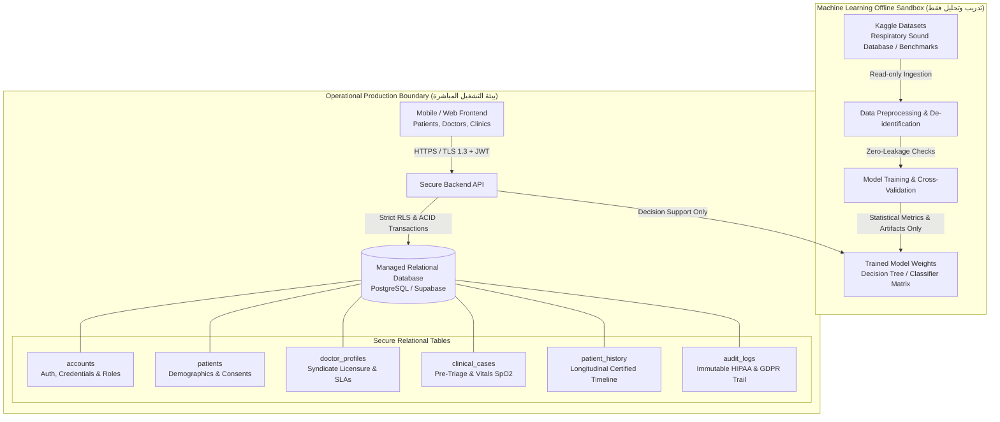
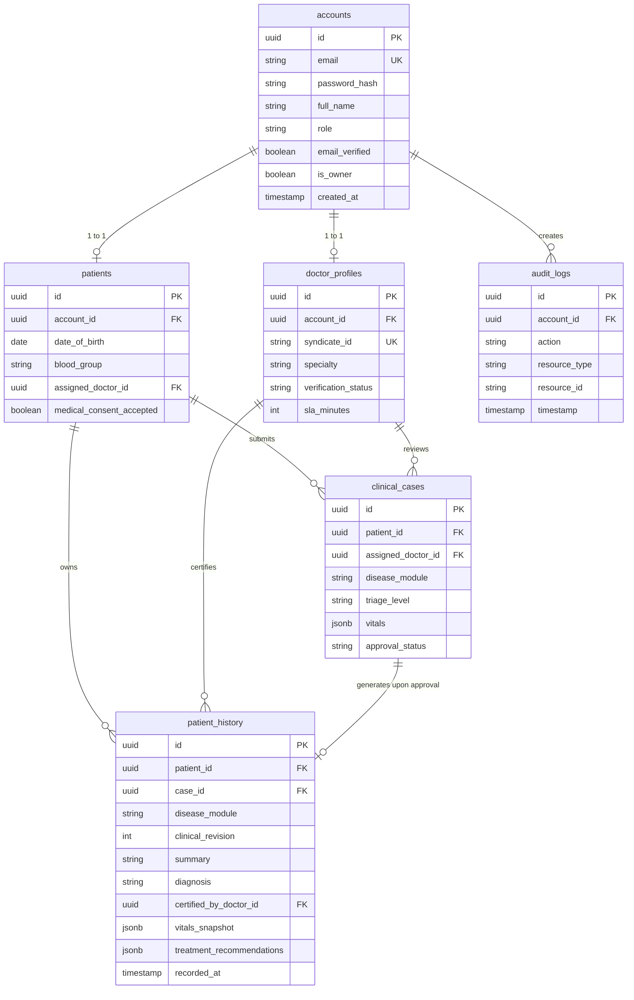

# Health Vibe AI - فصل بيانات التدريب عن التشغيل وقاعدة البيانات العلائقية (PRD Page 16)

## 📌 1. المرجع والمتطلب التقني الإلزامي من وثيقة متطلبات المنتج (PRD)

تنص **الصفحة 16 (القسم 13.1 - تصحيح تقني مهم)** من وثيقة متطلبات المنتج (PRD) على الآتي حرفياً:

> **تصحيح تقني مهم:**
> **"Kaggle ليس Production Database.** يمكن استخدامه كمصدر Datasets للتدريب/التجربة فقط.
> قاعدة بيانات المرضى والحسابات والـ Patient History يجب أن تكون **قاعدة بيانات آمنة منفصلة علائقية مُدارة (PostgreSQL / Supabase)** في مرحلة الإنتاج."

---

## 🛡️ 2. مبدأ الفصل المعماري التام (Architectural Separation Boundary)

---

## 🔒 3. قواعد الحماية الصارمة لبيانات المرضى (Zero-Leakage Protection)

1. **حظر تام لاستخدام Kaggle كقاعدة بيانات تشغيلية:**
   - خدمة `KaggleTrainingService` تفرض استثناء معماري فوري (`KAGGLE_NOT_PRODUCTION_DATABASE`) عند محاولة استدعاء أي عمليات حفظ حسابات أو سجلات طبية على مصادر تدريب Kaggle.
   - خدمة `RelationalDatabaseService` تفحص منشأ البيانات وتمنع حقن أي سجلات غير موثقة في الجداول التشغيلية (`KAGGLE_OPERATIONAL_WRITE_BLOCKED`).

2. **التدريب على بيانات منزوعة الهوية (Safe Harbor De-identification):**
   - تخضع أي عينة تدريبية لفحص إلزامي لخلوها من كافة المعرفات الـ 18 وفق معيار HIPAA (الأسماء، الهواتف، الأرقام القومية، العناوين، وبطاقات الدفع).

3. **حفظ الحسابات والـ Patient History في قاعدة بيانات علائقية متوافقة مع ACID:**
   - جدول `accounts`: تشفير كلمات المرور، تتبع عدد محاولات الدخول الخاطئة لمنع هجمات القوة الغاشمة، وفصل الصلاحيات (RBAC).
   - جدول `patient_history`: سجل طبي زمني غير قابل للتعديل (Immutable Append-only)، يوثق رقم المراجعة السريرية (`clinical_revision`)، توقيع الطبيب المعالج، لقطة المؤشرات الحيوية (`vitals_snapshot`)، والتوصيات العلاجية.

---

## 🗄️ 4. مخطط الكيانات والعلاقات (Relational ERD)

---

## 🛡️ 5. سياسات أمان مستوى الصفوف (Row Level Security - RLS)

تضمن السياسات في [schema.sql](file:///d:/MY%20PC/Coding/Health%20Vibe%20Ai/backend/db/schema.sql) الآتي على مستوى محرك قاعدة البيانات:
- **خصوصية المريض:** لا يستطيع المريض قراءة أو تعديل أي سجل في `patients` أو `patient_history` إلا إذا كان مرتبطاً بـ `auth.uid()` الخاص به.
- **حدود وصول الطبيب:** لا يستطيع الطبيب قراءة السجلات السريرية والـ History إلا للمرضى المسندين إليه رسمياً أو الحالات التي قام بمراجعتها واعتمادها.
- **جدول التدقيق غير القابل للتعديل:** جدول `audit_logs` يقبل الإضافة فقط (`FOR INSERT WITH CHECK (TRUE)`) ومحمي من أي عمليات `UPDATE` أو `DELETE` لضمان الامتثال لمتطلبات HIPAA و GDPR Art. 30.
