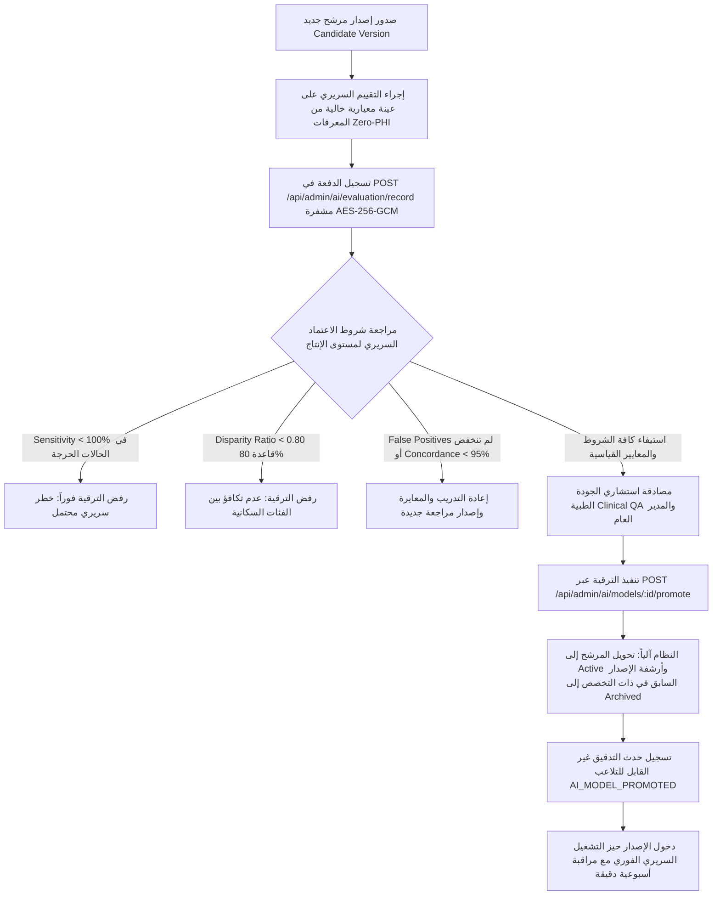
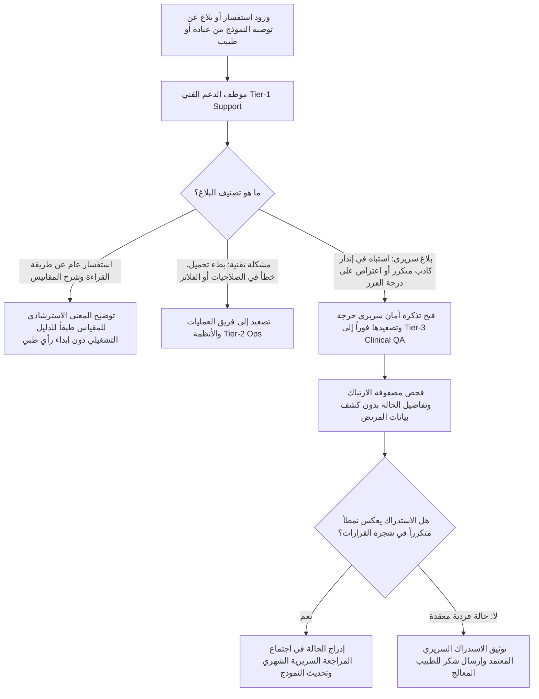

# 🩺 خطوات العمل القياسية لإدارة ومراقبة جودة نماذج الذكاء الاصطناعي السريرية
## (AI Model Quality Monitoring, Metric Auditing & Clinical Support SOPs)
### كود الوثيقة: `SOP-AI-042` | معيار إنفيرميديكا السريري (Infermedica Benchmark)

---

| **بيانات الوثيقة القياسية** | **التفاصيل التشغيلية والسريرية** |
|---|---|
| **كود الوثيقة (Document Code):** | `SOP-AI-042` (Quality & Clinical Operations Series) |
| **تاريخ الإصدار والاعتماد:** | 22 أكتوبر 2026 |
| **الإصدار الحالي:** | الإصدار v2.5 (Infermedica Medical AI Quality Standard) |
| **المعيار السريري المرجعي:** | Infermedica Clinical AI Benchmark & FDA Good Machine Learning Practice (GMLP) |
| **الأطر التشريعية والرقابية:** | GDPR Article 89 & Article 22 (Art. 89 / Art. 22)، HIPAA Safe Harbor (45 CFR § 164.514)، قانون حماية البيانات الشخصية المصري رقم 151 لسنة 2020 |
| **الفئة المستهدفة:** | مدراء النظام العام (Super Admins)، مسؤولو الجودة الطبية والبحوث السريرية (Clinical QA & Research Leads)، مهندسو وفنيو العمليات (Operations / Ops)، مدراء المراكز والمستشفيات (Clinic & Org Admins)، فريق الدعم الفني وخدمة العملاء (Customer Support & Medical Helpdesk)، والمراجعون السريريون (Clinical Reviewers). |

---

## 1. الغرض ونطاق التطبيق (Purpose & Regulatory Scope)

تهدف هذه الوثيقة القياسية (`SOP-AI-042`) إلى توحيد وتفصيل كافة الإجراءات التشغيلية والسريرية المتعلقة بمراقبة، تدقيق، ومعايرة نماذج الذكاء الاصطناعي الطبية المعتمدة في منصة **Health Vibe AI** (وبالأخص نماذج الفرز التنفسي الحاد، نقص الأكسجة SpO2 Guard، مصنف الأعراض المعقدة SymptomNet، ونماذج الأطفال Pediatric Protocols).

### أهداف المنظومة التشغيلية:
1. **التحقق المستمر من السلامة السريرية (Clinical Safety First):** ضمان تحقيق حساسية تامة بنسبة $100\%$ في كشف الحالات التنفسية الحرجة وانعدام السلبيات الكاذبة ($FN = 0$) لمنع أي ضرر للمرضى.
2. **تقليص العبء السريري والإنذارات الكاذبة:** متابعة معدلات الإنذارات الكاذبة (False Positives) والتأكد من انخفاضها المستمر (بنسبة $80\%$ في نموذج $v1.1$ مقارنة بـ $v1.0$).
3. **الامتثال لمبدأ الامتياز الأدنى (Least Privilege RBAC):** قصر صلاحيات ترقية النماذج وتعديل المعايرات على الإدارة العليا وفريق الجودة الطبية حصراً، مع منح صلاحيات القراءة التجميعية لفرق العمليات والمراكز، ومنع وصول أي دور غير مصرح به.
4. **العزل التام للمعلومات الصحية الشخصية (Zero-PHI Guarantee):** قصر تحليلات مراقبة النماذج على مصفوفات الارتباك المجمعة والنسب الرياضية المشفرة بـ `AES-256-GCM`، وحظر تمرير أي أسماء أو أرقام هواتف أو أرقام قومية للمرضى.
5. **سيادة القرار الطبي البشري (Physician Primacy):** التأكيد القانوني والتشغيلي على أن الذكاء الاصطناعي هو أداة مساعدة لدعم القرار الطبي (*Decision-Support Tool*) وأن الاستشاري البشري هو صاحب الكلمة العليا مع توثيق كافة الاستدراكات الطبية (*Physician Overrides*).

---

## 2. مصفوفة الصلاحيات والمسؤوليات (RBAC & RACI Responsibility Matrix)

يوضح الجدول التالي مصفوفة توزيع المسؤوليات والصلاحيات الدقيقة وفق نموذج **RACI** (المسؤول Responsible، المساءل Accountable، المستشار Consulted، المبلَّغ Informed):

| المهمة التشغيلية / السريرية | Super Admin | Clinical QA | Ops Admin | Clinic/Org Admin | Support Desk | Doctor / Physician | Patient |
|---|:---:|:---:|:---:|:---:|:---:|:---:|:---:|
| **عرض المقاييس العامة ولوحة التحكم (`GET /api/admin/ai/models`)** | **A** | **R** | **R** | **I** | حظر (403) | حظر (403) | حظر (403) |
| **فحص تفاصيل النموذج ومصفوفة الارتباك (`GET /models/:id`)** | **A** | **R** | **R** | **I** | حظر (403) | حظر (403) | حظر (403) |
| **تسجيل دفعة تقييم أو معايرة (`POST /evaluation/record`)** | **A** | **R** | حظر (403) | حظر (403) | حظر (403) | حظر (403) | حظر (403) |
| **ترقية النموذج المرشح للإنتاج (`POST /models/:id/promote`)** | **A** | **R** | حظر (403) | حظر (403) | حظر (403) | حظر (403) | حظر (403) |
| **تصدير تقارير التقييم السريري (`GET /export`)** | **A** | **R** | **R** | **I** | حظر (403) | حظر (403) | حظر (403) |
| **تدقيق تكافؤ الفئات السكانية (Four-Fifths Disparity Rule)** | **I** | **A / R** | **C** | **I** | غير متاح | غير متاح | غير متاح |
| **مراجعة استدراكات الأطباء (Physician Overrides Review)** | **I** | **A / R** | **C** | **I** | **I** | **R** (محرر الاستدراك) | غير متاح |
| **استقبال وتصعيد بلاغات الأطباء عن دقة التوصيات** | **I** | **A** (مستوى 3) | **R** (مستوى 2) | **I** | **R** (مستوى 1) | **C** (المبلغ) | غير متاح |
| **مراجعة سجلات التدقيق القانونية (`audit_events`)** | **A** | **C** | **I** | غير متاح | غير متاح | غير متاح | غير متاح |

*دلالات الرموز: **A** (مساءل نهائي ومصادق)، **R** (منفذ ومسؤول)، **C** (مستشار)، **I** (مبلّغ للعلم).*

---

## 3. مخططات مسار العمليات (Operational Workflow Diagrams)

### أ. مخطط تقييم وترقية النماذج السريرية (Evaluation & Promotion Decision Flow)

---

### ب. مخطط تصعيد بلاغات الدعم الفني واستدراكات الأطباء (Support & Physician Escalation)

---

## 4. إجراءات العمل القياسية خطوة بخطوة (Step-by-Step SOPs)

### SOP-AI-01: المراقبة الدورية للوحة التحكم وفلاتر النماذج (Routine Monitoring & KPI Inspection)
* **المسؤول:** مسؤولو الجودة الطبية (`clinical_qa`) ومهندسو العمليات (`ops`).
* **التكرار:** يومي (فريق العمليات) وأسبوعي (فريق الجودة الطبية).
* **الهدف:** التأكد من استقرار المقاييس التشغيلية وانضباط نماذج الذكاء الاصطناعي النشطة.

#### خطوات التنفيذ:
1. تسجيل الدخول إلى منصة **Health Vibe AI** بحساب معتمد يحمل دور `clinical_qa` أو `ops` أو `super_admin`.
2. الانتقال إلى القائمة الجانبية واختيار **مراقبة جودة الذكاء الاصطناعي (AI Monitoring Dashboard)** أو التوجه مباشرة إلى:
   `app/modules/admin/ai-monitoring-view.html`.
3. فحص بطاقات المقاييس التجميعية الكلية (Macro Aggregate Metrics) في أعلى اللوحة:
   - **متوسط الحساسية (Macro Sensitivity):** يجب ألا يقل عن $98.5\%$ في جميع الأوقات.
   - **متوسط النوعية (Macro Specificity):** يجب ألا يقل عن $92.0\%$.
   - **متوسط توافق الأطباء (Macro Doctor Concordance):** يجب ألا يقل عن $95.0\%$.
   - **إجمالي النماذج المفحوصة (Models Under Governance):** التأكد من ظهور كامل نماذج الكتالوج (5 نماذج معتمدة).
4. استخدام فلاتر البحث والتدقيق متعددة المعايير:
   - **فلتر الحالة (`Status`):** تصفية النماذج النشطة (`Active`)، المرشحة (`Candidate`)، والمؤرشفة (`Archived`).
   - **فلتر التخصص السريري (`Condition Scope`):** الفرز التنفسي الحاد (`respiratory_triage`)، فحص الأكسجة (`hypoxemia`)، الأطفال (`pediatric`)، أو الحالات المعقدة (`pneumonia_covid`).
   - **فلتر النطاق الزمني (`Time Range`):** مراجعة آخر 7 أيام، 30 يوماً، أو كامل السجل التقييمي.
   - **حقل البحث النصي المباشر (`Search`):** البحث باسم النموذج أو التقنية (مثل: `Bayesian`, `v1.1`, `XGBoost`).
5. النقر على بطاقة النموذج المستهدف أو زر **`عرض التفاصيل السريرية (Inspect Model)`** لفتح نافذة الفحص المعمق.

---

### SOP-AI-02: تدقيق العدالة السريرية وتكافؤ الفئات السكانية (Demographic Parity & Sub-Cohort Auditing)
* **المسؤول:** قائد الجودة الطبية والبحوث السريرية (`clinical_qa`).
* **التكرار:** أسبوعياً وعند مراجعة أي إصدار مرشح للترقية.
* **المرجعية:** معيار الأربعة أخماس المعترف به دولياً في عدالة الذكاء الاصطناعي (*Four-Fifths / 80% Rule - EEOC & Infermedica Standard*).

#### خطوات التنفيذ:
1. فتح نافذة تفاصيل النموذج المعني (مثل النموذج المرشح `model_v1_1_candidate`).
2. الانتقال إلى قسم **تدقيق الفئات السكانية والمجموعات الفرعية (Sub-Cohort Demographic Breakdown)**.
3. التحقق من توافر المقاييس للأربع فئات السريرية الأساسية:
   - **الأطفال والرضع (`Pediatric`):** (حجم العينة $N \ge 15$).
   - **البالغون (`Adult`):** (حجم العينة $N \ge 40$).
   - **كبار السن فوق 65 عاماً (`Geriatric`):** (حجم العينة $N \ge 20$).
   - **مرضى الأمراض الصدرية المزمنة (`Chronic Lung Disease`):** الربو والانسداد الرئوي (حجم العينة $N \ge 20$).
4. **التدقيق الإلزامي لشرط السلامة السريرية (Zero-Harm Critical Safety):**
   - التأكد التام من أن الحساسية في الحالات الحرجة تساوي **$100\%$ ($1.000$)** في كل فئة على حدة دون أي تهاون.
   - في حال وجود حالة سلبية كاذبة واحدة ($FN \ge 1$) في أي فئة حرجة، يُرفض النموذج تلقائياً ويُمنع من النشر.
5. **احتساب نسبة التكافؤ للفئات (Disparity Ratio):**
   - حصر قيم النوعية (*Specificity*) للفئات الأربع:
     $$\text{Disparity Ratio} = \frac{\min(\text{Specificity})}{\max(\text{Specificity})}$$
   - تطبيق القاعدة الرياضية:
     $$\text{Disparity Ratio} \ge 0.80 \quad (80\%)$$
   - *مثال نموذج v1.1 المعتمد:*
     $$\min(\text{Spec}) = 0.900 \text{ (مرضى الرئة)}, \quad \max(\text{Spec}) = 0.952 \text{ (البالغين)} \implies \text{Ratio} = \frac{0.900}{0.952} = 94.5\% \ge 80\% \quad \text{(ناجح ومطابق)}$$
6. توثيق النتيجة في تقرير التدقيق السريري الأسبوعي.

---

### SOP-AI-03: تقييم وتسجيل دفعات المعايرة السريرية الجديدة (Recording Evaluation Batches)
* **المسؤول:** مسؤولو الجودة الطبية (`clinical_qa`) والمدير العام (`super_admin`).
* **الهدف:** إدخال نتائج دراسات التحقق السريري الاسترجاعية أو الاستباقية لتحديث مصفوفة أداء النماذج.

#### متطلبات ما قبل التنفيذ (Prerequisites & Zero-PHI Guard):
- **حظر صارم للمعلومات الصحية:** يُمنع تماماً إدخال أي أسماء مرضى، أرقام ملفات طبية، أرقام قومية، أرقام هواتف، أو ملاحظات طبية نصية.
- يتم إدخال بيانات مصفوفة الارتباك الإجمالية فقط ($TP, FP, TN, FN$)، معدل توافق الأطباء الإجمالي، وملاحظات المعايرة العامة.

#### خطوات التنفيذ:
1. إعداد مصفوفة الارتباك المجمعة الناتجة عن الدراسة السريرية:
   - الإيجابيات الحقيقية ($TP$): الحالات الحرجة المكتشفة بنجاح.
   - الإيجابيات الكاذبة ($FP$): حالات غير حرجة صنفت خطأً كحرجة (إنذار كاذب).
   - السلبيات الحقيقية ($TN$): حالات مستقرة صنفت بنجاح كمستقرة.
   - السلبيات الكاذبة ($FN$): حالات حرجة أهملها النموذج (مطلوب $0$).
2. من لوحة مراقبة الذكاء الاصطناعي، النقر على زر **`+ تسجيل دفعة تقييم سريري جديدة (Record Evaluation)`**.
3. استيفاء الحقول في نموذج التسجيل:
   - **معرف النموذج (`Model ID`):** اختيار النموذج المستهدف (مثال: `model_hypoxemia_v1_2`).
   - **اسم دفعة التقييم (`Batch Name`):** مثال: `معايرة سريرية استباقية - غرف العناية المركزة Q4 2026`.
   - **إصدار مجموعة البيانات المرجعية (`Dataset Version`):** مثال: `HealthVibe-Validation-v2.1`.
   - **قيم مصفوفة الارتباك:** إدخال $TP, FP, TN, FN$ وحجم العينة.
   - **توافق الأطباء:** عدد الحالات المتوافقة وإجمالي الحالات ومعدل التوافق.
   - **ملاحظات المعايرة السريرية:** ملخص استنتاجات الفريق الطبي.
4. النقر على **`حفظ وتشفير الدفعة (Submit & Encrypt)`**.
5. يقوم النظام بالآتي بصورة آلية وفورية:
   - فحص الحقول لضمان عدم وجود أي معلومات مريض سرية (`detectAiPhiLeakage`).
   - تشفير البيانات الحساسة فورياً بخوارزمية `AES-256-GCM` مفتاح 256 بت مع رقم مصادقة Tag 128 بت وحفظها في Firestore.
   - تسجيل حدث تدقيق رسمي في `audit_events` بالرمز `AI_MODEL_EVALUATED`.
   - إعادة احتساب نسب الحساسية والنوعية ودقة التوافق آلياً للنموذج.

---

### SOP-AI-04: ترقية واعتماد النماذج للإنتاج (Candidate Promotion & Deprecation)
* **المسؤول:** مسؤولو الجودة الطبية (`clinical_qa`) وبمصادقة نهائية من المدير العام (`super_admin`).
* **الهدف:** ترقية الإصدار المرشح المتميز ليصبح الإصدار الفعال في بيئة الإنتاج السريري، مع أرشفة الإصدار السابق تلقائياً ودون انقطاع في الخدمة.

#### معايير الترقية الإلزامية للإنتاج السريري (Gate Criteria):
| المعيار السريري | الحد الأدنى المطلوب للترقية | أداء نموذج v1.1 المرشح |
|---|:---:|:---:|
| **الحساسية للحالات الحرجة (Critical Sensitivity):** | **$100.0\%$** ($FN = 0$) | **$100.0\%$** (محقق) |
| **النوعية (Specificity):** | $\ge 90.0\%$ | **$94.7\%$** (محقق) |
| **معدل تخفيض الإنذارات الكاذبة (FP Reduction):** | انخفاض $\ge 50\%$ مقارنة بالنسخة النشطة | **انخفاض $80\%$** (من 10 إلى 2) |
| **توافق الأطباء الاستشاريين (Doctor Concordance):** | $\ge 95.0\%$ | **$97.5\%$** (محقق) |
| **مؤشر تكافؤ الفئات (Disparity Ratio):** | $\ge 80.0\%$ | **$94.5\%$** (محقق) |
| **المساحة تحت منحنى الخواص (AUC-ROC):** | $\ge 0.990$ | **$0.998$** (محقق) |

#### خطوات التنفيذ:
1. فتح بطاقة النموذج المرشح المستوفي لكافة الشروط في لوحة المراقبة (مثل `model_v1_1_candidate`).
2. النقر على زر **`ترقية النموذج إلى الإنتاج (Promote to Active)`**.
3. تظهر نافذة تأكيد الإقرار السريري والقانوني تتضمن:
   - ملخص مقارن بين الإصدار الحالي والإصدار الجديد المرشح.
   - التنبيه على أن الإصدار النشط حالياً في ذات التخصص سيتم تحويله تلقائياً وبشكل ذري إلى أرشيف معتمد (`archived`).
4. كتابة اسم المشرف وتأكيد المصادقة.
5. يقوم النظام فورياً عبر الواجهة الخلفية الآمنة (`POST /api/admin/ai/models/:modelId/promote`):
   - بالتحقق من الصلاحيات المشددة (رفض أي دور عدا Super Admin و Clinical QA).
   - تحديث حالة النموذج المرشح إلى `active`.
   - أرشفة النماذج السابقة لنفس التخصص (`archived`).
   - تدوين حدث رقابي غير قابل للتعديل `AI_MODEL_PROMOTED` مع طابع زمني دقيق وهوية المنفذ.
6. تحديث فوري لكافة وحدات الفرز السريري دون الحاجة لإعادة تشغيل الخادم.

#### بروتوكول التراجع السريع عند الطوارئ (Emergency Rollback Protocol):
- في حال حدوث أي تقرير عن تذبذب غير متوقع في توصيات النموذج الجديد خلال الـ 24 ساعة الأولى:
  1. يقوم مسؤول الجودة أو المدير العام بفتح بطاقة النموذج السابق من الأرشيف (`model_v1_0_active`).
  2. النقر على **`إعادة تفعيل الإصدار السابق (Reactivate Previous Version)`**.
  3. يعود الإصدار السابق فوراً كإصدار نشط ويتحول الإصدار الجديد إلى حالة تعليق قيد المراجعة (`suspended`).
  4. فتح بطاقة حادث أمني وسريري وتسجيلها في سجل المخاطر الطبية.

---

### SOP-AI-05: فحص وتدقيق استدراكات الأطباء وسيادة القرار السريري (Physician Overrides & Primacy)
* **المسؤول:** مسؤولو الجودة السريرية (`clinical_qa`)، بالتنسيق مع استشاريي المراكز الطبية.
* **الهدف:** دراسة الحالات التي قرر فيها الطبيب البشري عدم الأخذ بتوصية الفرز الصادرة عن الذكاء الاصطناعي، لضمان التحسين المستمر وصيانة أمان المرضى.

#### المبادئ الحاكمة:
1. **السيادة المطلقة للقرار الطبي البشري:** منصة Health Vibe AI مصممة كأداة دعم قرار استرشادية، وقرار الطبيب المعالج يعلو في كافة الحالات دون أي استثناء.
2. **الاستدراك السريري ليس خطأً:** تسجيل الطبيب لاستدراك (*Override*) يُعد مساهمة علمية قيمة لتطوير المنظومة ومكافأة سريرية لليقظة الطبية.

#### خطوات المراجعة الشهرية:
1. من تفاصيل النموذج في لوحة المراقبة، مراجعة بند **توافق الأطباء والاستدراكات السريرية (Doctor Concordance & Overrides)**:
   - قراءة عدد الحالات المتوافقة مقابل عدد الاستدراكات المسجلة (مثال: في $v1.1$ بلغ التوافق 78 حالة واستدراكين من أصل 80 حالة = $97.5\%$).
2. فحص أسباب الاستدراك الموثقة من الأطباء:
   - **السبب الأول الشائع:** مؤشرات حيوية حدية (مثل مريض نسبة تشبع الأكسجين لديه $92\%$ ولكنه يعاني من مرض رئوي انسدادي مزمن قديم ويعتبر هذا رقمه الأساسي المعتاد Baseline).
   - **السبب الثاني الشائع:** وجود عوامل خطورة اجتماعية أو صعوبة في وصول المريض للطوارئ ليلاً، مما دفع الطبيب لرفع درجة الحذر.
3. يقوم فريق الجودة السريرية بعقد اجتماع المراجعة الشهرية مع لجنة الاستشاريين.
4. إدراج الملاحظات كقواعد فحص جديدة (*Rule-Based Guardrails*) في الإصدار التالي من النموذج.

---

### SOP-AI-06: دليل فريق الدعم الفني وتصعيد الاستفسارات والشكاوى (Support Team Playbook)
* **المسؤول:** موظفو الدعم الفني وخدمة العملاء (`support`)، مشرفو العمليات (`ops`)، ومسؤولو الجودة (`clinical_qa`).
* **الهدف:** توجيه موظف الدعم للتعامل الاحترافي والقانوني السليم عند ورود أي استفسار أو شكوى تتعلق بتوصيات الذكاء الاصطناعي.

#### مستويات التصعيد الثلاثة (Three-Tier Escalation Model):

| المستوى | المسؤول | نطاق الاختصاص | زمن الاستجابة الأقصى (SLA) |
|---|---|---|---|
| **المستوى 1 (Tier 1)** | موظف الدعم الفني (Customer Support) | استفسارات عامة، شرح المصطلحات الطبية، إرشاد الأطباء لاستخدام النموذج | 15 دقيقة |
| **المستوى 2 (Tier 2)** | مهندس العمليات والأنظمة (Operations / Ops) | مشاكل تقنية: بطء الاستجابة، خطأ 500، عدم تحديث شاشة التقييم | 30 دقيقة |
| **المستوى 3 (Tier 3)** | رئيس الجودة الطبية والبحوث (Clinical QA Lead) | بلاغات عدم الدقة السريرية، شكاوى الإنذارات الكاذبة، استفسارات اللجان الطبية | 30 دقيقة (حرجة) / 4 ساعات (عادية) |

#### تعليمات وإرشادات حاسمة لموظفي الدعم الفني (Support Rules of Engagement):
1. **يُحظر تماماً إبداء أي رأي طبي أو نصيحة سريرية:** موظف الدعم لا يملك الصفة الطبية ولا يجوز له تحت أي ظرف مناقشة التشخيص أو العلاج.
2. **العبارة المعيارية الإلزامية للمحادثات:**
   > *"أهلاً بك يا دكتور. نود التأكيد على أن توصيات المنظومة الذكية هي إرشادات استئناسية لدعم اتخاذ القرار، وقرار سيادتكم السريري هو المرجع النهائي والمعتمد لصحة المريض. تم تسجيل استدراككم وملاحظتكم وسيتم تحويلها فوراً إلى لجنة الجودة السريرية للدراسة."*
3. **نموذج تذكرة التصعيد السريري (Clinical Escalation Ticket):**
   عند تصعيد بلاغ إلى المستوى الثالث (`clinical_qa`)، يتم تعبئة الحقول التالية حصراً:
   - رقم التذكرة ومعرّف العيادة أو الطبيب المبلغ.
   - معرّف النموذج المستخدم وإصداره (مثل: `HealthVibe-Triage-v1.1`).
   - تصنيف الملاحظة: (إنذار كاذب FP / حساسية منخفضة / اقتراح تحسين).
   - ملخص الاستدراك الطبي دون إدراج اسم المريض أو رقمه القومي.

---

### SOP-AI-07: تصدير التقارير الرقابية والامتثال القانوني (Compliance Export & Regulatory Reporting)
* **المسؤول:** مسؤولو الجودة الطبية (`clinical_qa`)، مهندسو العمليات (`ops`)، والمدير العام (`super_admin`).
* **الهدف:** استخراج تقارير التقييم السريري المعتمدة لتقديمها إلى الجهات الصحية الرقابية والمستشفيات المشاركة.

#### خطوات التنفيذ:
1. الانتقال إلى أعلى يسار لوحة مراقبة الذكاء الاصطناعي.
2. النقر على قائمة **`تصدير التقارير المعتمدة (Export Clinical Audit)`**.
3. اختيار الصيغة المطلوبة:
   - **تقرير التقييم بصيغة CSV (`Export CSV`):** جدول مفصل يحتوي على النماذج، الإصدارات، الحساسية، النوعية، الدقة الإيجابية، F1-Score، معدل التوافق، وأعداد مصفوفة الارتباك.
   - **التقرير البرمجي المشفر بصيغة JSON (`Export JSON`):** كائن برمجي موثق يحتوي على التفاصيل الكاملة متضمنة نقاط منحنى الخصائص (ROC Points) وتوزيع الفئات السكانية.
4. يقوم النظام بإنشاء الملف وتنزيله تلقائياً مع تطبيق ترويسات الأمان الصارمة:
   - `Cache-Control: no-store, no-cache, must-revalidate` لمنع التخزين المؤقت في المتصفحات غير الآمنة.
   - `X-Content-Type-Options: nosniff`.
   - اسم الملف يتبع النمط القياسي المؤرخ: `healthvibe-ai-models-audit-YYYY-MM-DD.csv`.
5. تسجيل حدث التدقيق الرقابي `AI_MODEL_EXPORTED` في سجلات التدقيق تلقائياً.

---

## 5. قوائم المراجعة والتحقق الدوري (Operational Checklists)

### أ. قائمة التحقق اليومي لفريق العمليات (Daily Ops Checklist):
- [ ] فحص عمل نقاط النهاية البرمجية `/api/admin/ai/models` واستجابتها برمز `200 OK` للمستخدمين المصرح لهم.
- [ ] التأكد من عدم وجود أي خطأ تشغيلي أو انقطاع في خوادم الفرز السريري.
- [ ] التأكد من تفعيل ترويسات الأمان ومنع محاولات الحقن والتسلل (مراجعة أحداث `AI_SECURITY_VIOLATION_BLOCKED`).
- [ ] التأكد من حظر أي طلبات غير مصادق عليها أو محاولات وصول بأدوار غير مصرحة (`401` و `403`).

### ب. قائمة التحقق الأسبوعي لفريق الجودة والبحوث السريرية (Weekly Clinical QA Checklist):
- [ ] فحص مؤشرات الحساسية والنوعية لجميع النماذج النشطة في الإنتاج.
- [ ] التحقق من استمرار نسبة توافق الأطباء فوق الحد الأدنى القياسي ($Concordance \ge 95\%$).
- [ ] مراجعة كافة الاستدراكات الطبية المسجلة خلال الأسبوع وفهرسة أسبابها.
- [ ] مراجعة تدقيق تكافؤ الفئات السكانية والتأكد من استيفاء قاعدة الأربعة أخماس ($Ratio \ge 0.80$).
- [ ] التحقق من عدم وجود أي سلبيات كاذبة في الحالات التنفسية الحرجة ($FN = 0$).

### ج. قائمة التحقق الشهري لحوكمة الذكاء الاصطناعي (Monthly AI Governance Checklist):
- [ ] عقد جلسة المراجعة السريرية المشتركة مع رؤساء الأقسام الطبية وممثلي المراكز.
- [ ] استخراج التقرير الشهري الرقابي المعتمد وأرشفته في سجل الامتثال القانوني.
- [ ] فحص سلامة التشفير `AES-256-GCM` لكافة دفعات التقييم المضافة في Firestore.
- [ ] مراجعة سجلات التدقيق والتأكد من مطابقة سجل الأحداث التراكمي `audit_events`.
- [ ] اتخاذ قرار ترقية أو اعتماد النماذج المرشحة الجديدة أو تحديث حزم البيانات المعيارية.

---

## 6. قاموس المصطلحات والمعادلات الرياضية السريرية (Glossary & Equations)

| المصطلح بالإنجليزية | المصطلح بالعربية | المعادلة الرياضية القياسية | التفسير والهدف السريري |
|---|---|:---:|---|
| **Sensitivity / Recall** | الحساسية السريرية | $\frac{TP}{TP + FN}$ | قدرة النموذج على التقاط كافة الحالات الحرجة. الهدف في الطوارئ: **$100\%$**. |
| **Specificity** | النوعية السريرية | $\frac{TN}{TN + FP}$ | قدرة النموذج على تمييز الحالات السليمة غير الحرجة وتجنب الإنذار الكاذب. الهدف: $\ge 90\%$. |
| **Precision (PPV)** | القيمة التنبؤية الإيجابية | $\frac{TP}{TP + FP}$ | احتمالية كون المريض المعلم بإنذار حرج يعاني فعلاً من حالة حرجة. |
| **F1-Score** | المعامل التوافقي F1 | $\frac{2 \times \text{Precision} \times \text{Sensitivity}}{\text{Precision} + \text{Sensitivity}}$ | التوازن الإحصائي بين الحساسية والدقة الإيجابية. |
| **AUC-ROC** | المساحة تحت منحنى الخواص | $\int_0^1 \text{TPR}(FPR) \, d(FPR)$ | دقة النموذج التمييزية الشاملة عبر مختلف عتبات التصنيف. الهدف: $\ge 0.99$. |
| **Doctor Concordance Rate** | معدل توافق الأطباء | $\frac{\text{Agreed Cases}}{\text{Total Cases}}$ | نسبة تطابق قرار الطبيب البشري مع توصية النموذج. الهدف: $\ge 95\%$. |
| **Wilson 95% CI** | فترة ثقة ويلسون | Wilson Score Interval Formula | فترات الثقة الإحصائية لضمان موثوقية النتائج حتى في العينات المتوسطة الحجم. |
| **Disparity Ratio** | نسبة التكافؤ السكاني | $\frac{\min(\text{Specificity})}{\max(\text{Specificity})}$ | قياس العدالة بين فئات الأطفال، البالغين، كبار السن، ومرضى الرئة المزمنين. الهدف: $\ge 0.80$. |

---

## 7. الاعتماد والمراجعة الإدارية (Sign-off & Governance Approval)

| الدور | الاسم والصفة | التاريخ | التوقيع |
|---|---|:---:|:---:|
| **قائد الجودة الطبية والبحوث:** | د. رئيس قسم الجودة والبحوث السريرية | 22 أكتوبر 2026 | *معتمد سريرياً* |
| **مدير العمليات والأنظمة:** | م. رئيس العمليات الرقمية والأنظمة | 22 أكتوبر 2026 | *معتمد تقنياً* |
| **المدير العام ومالك المنظومة:** | الإدارة العامة — Health Vibe AI | 22 أكتوبر 2026 | *مصادق نهائياً ومفعل للإنتاج* |

---
*تم إعداد هذه الوثيقة وفق أعلى معايير الجودة السريرية الدولية (Infermedica Standard & FDA GMLP Guidelines).*
