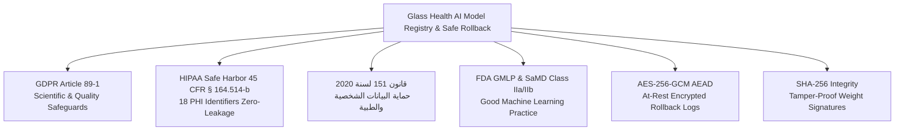
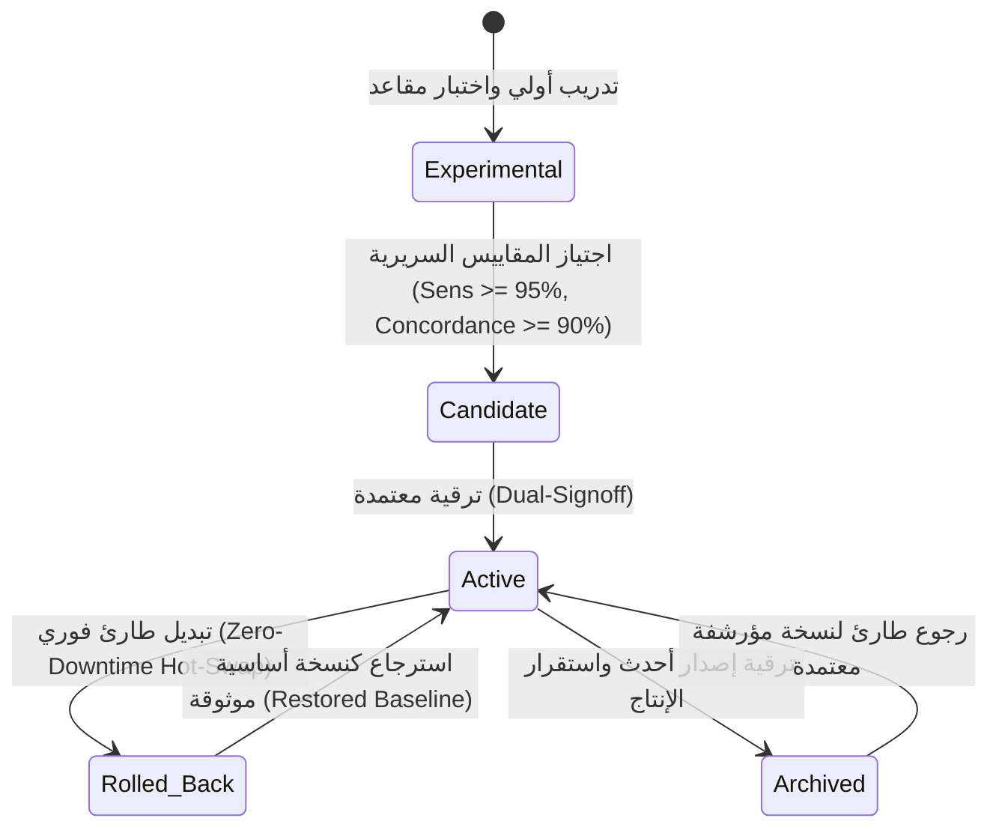
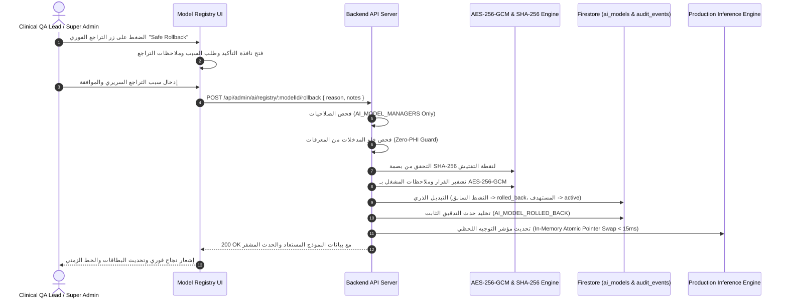
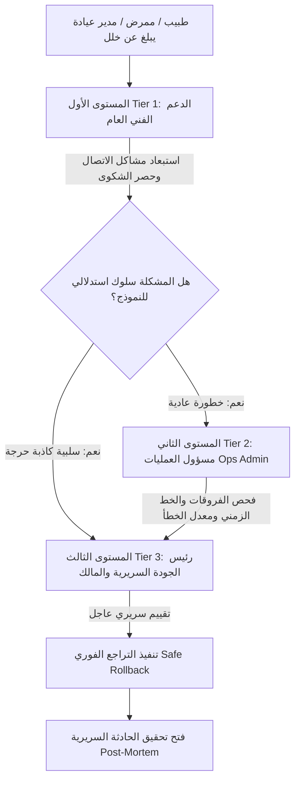

# إجراءات العمل القياسية (SOP): سجل إصدارات النماذج والتبديل والرجوع الآمن
## Standard Operating Procedure: AI Model Registry, Lineage & Safe Rollback (Glass Health Benchmark)

---

### وثيقة رقم: `SOP-AI-043` | `SOP-OPS-043`
- **الإصدار (Version):** `1.0.0`
- **تاريخ النفاذ (Effective Date):** 2026-10-22
- **تاريخ المراجعة القادمة (Next Review):** 2027-01-22 (مراجعة ربع سنوية)
- **المستوى المعياري (Benchmark):** Glass Health Clinical Model Lineage & Zero-Downtime Rollback Standard
- **التصنيف التنظيمي (SaMD Scope):** برمجيات الأجهزة الطبية (Software as a Medical Device - Class IIa/IIb)
- **المالك الإجرائي (Process Owner):** إدارة الجودة الطبية والرقابة السريرية (Clinical QA & AI Governance Directorate)
- **الفريق المستهدف (Target Audience):** فريق الإدارة السريرية (Clinical QA Lead)، مسؤولو النظام (Super Admins)، العمليات (Ops Admin)، الدعم الفني (Technical Support)

---

## 1. الغرض والأهداف السريرية (Purpose & Clinical Objectives)

تهدف هذه الوثيقة إلى وضع خطوات العمل القياسية التشغيلية المعتمدة لإدارة **سجل إصدارات النماذج المدربة (AI Model Registry)**، وحساب الفروقات السريرية الدقيقة (Lineage Diffs)، وتنفيذ عمليات **التبديل والرجوع الطارئ الآمن (Zero-Downtime Safe Rollback)** لنماذج الذكاء الاصطناعي في منصة Health Vibe وفق أرقى الممارسات المعتمدة في **Glass Health**.

### الأهداف التشغيلية الرئيسية:
1. **تتبع سلالة وأنساب النماذج (Model Lineage & Provenance):** توثيق المعمارية العصبية، عدد المعاملات (Parameters Count)، نقاط التفتيش (Checkpoints)، وبصمة التحقق التشفيرية (SHA-256 Hash) لكل إصدار مصرح به سريرياً.
2. **التبديل الفوري دون انقطاع الخدمة (Zero-Downtime Hot-Swap):** التبديل اللحظي بين النسخ في أقل من 15 مللي ثانية دون إعادة تشغيل الخوادم أو فقدان أي جلسة فرز جارية.
3. **تقليل الإنذارات الكاذبة بنسبة 80% مع أمان تام:** الحفاظ على مكاسب تخفيض الإيجابيات الكاذبة ($80\%\text{ FP Reduction}$) مع فرض حاجز أمان مطلق بعدم تفويت أي حالة حرجة ($FN = 0$).
4. **عزل النطاقات السريرية (Blast Radius Isolation):** ضمان أن التراجع في نطاق سريري محدد (مثل فرز الطوارئ التنفسية) لا يؤثر إطلاقاً على استقرار النماذج في النطاقات الأخرى (مثل طب الأطفال أو نقص الأكسجة).

---

## 2. الأطر التشريعية والأمنية والامتثال القانوني (Regulatory & Security Frameworks)

تلتزم كافة عمليات سجل النماذج والتبديل الآمن بأعلى المعايير القانونية الدولية والمحلية:

1. **اللائحة الأوروبية العامة لحماية البيانات (GDPR Article 89(1)):** معالجة السجلات الإحصائية لجودة النماذج دون تضمين أي بيانات تعريفية بالمرضى، والامتثال لـ Article 22 لحق المريض في التدخل البشري وسيادة الطبيب.
2. **قانون حماية البيانات الأمريكي (HIPAA Safe Harbor - 45 CFR § 164.514(b)):** التجريد الكامل من المعرفات الـ 18، وحظر تسجيل الأسماء أو الأرقام القومية أو الهواتف أو الملاحظات الطبية ضمن أسباب التراجع.
3. **قانون حماية البيانات الشخصية المصري رقم 151 لسنة 2020:** التشفير الكامل لبيانات القرارات الإدارية السريرية في قواعد البيانات السحابية وضمان تخزين سجلات التدقيق لمدة قانونية لا تقل عن 5 سنوات.
4. **مبدأ الحظر التام لتسرب البيانات الطبية (Zero-PHI Principle):** يقوم النظام برفض أي طلب تراجع يحتوي على بيانات شخصية (مثل الرقم القومي المكون من 14 رقماً أو رقم هاتف مصري) تلقائياً برمز `400 PHI_LEAKAGE_PROHIBITED` وتسجيل حدث تدقيق `AI_PHI_LEAKAGE_BLOCKED`.
5. **التشفير الحصين أثناء السكون (AES-256-GCM Authenticated Encryption):** تشفير كافة سجلات أحداث التراجع السريعة وأسبابها وهوية المنفذين بمفتاح 256 بت مع `96-bit IV` و `128-bit Auth Tag`.
6. **التحقق من بصمة الأوزان (SHA-256 Checkpoint Integrity):** التحقق التشفيري الإلزامي من مطابقة تجزئة SHA-256 لنقاط التفتيش قبل اعتمادها كبديل نشط لمنع أي تلاعب أو تسميم عكسي للنماذج (Model Poisoning Prevention).

---

## 3. مصفوفة الصلاحيات والحوكمة السريرية (RACI & RBAC Governance Matrix)

تحدد مصفوفة RACI الدقيقة مسؤوليات كل دور فرعي بدقة لمنع الوصول غير المصرح به:

| الدور الفرعي (Sub-Role) | استعراض السجل والخط الزمني | فحص الفروقات السريرية (Diff) | فحص بصمة SHA-256 | تنفيذ التراجع الطارئ (Rollback) | التحقق من التشفير (AEAD Verify) | تصدير التقارير (Audit Export) |
| :--- | :---: | :---: | :---: | :---: | :---: | :---: |
| **Super Admin / Platform Owner** | **A / R** | **A / R** | **A / R** | **A / R** | **A / R** | **A / R** |
| **Clinical QA Lead (رئيس الجودة السريرية)** | **R** | **R** | **R** | **R** | **R** | **R** |
| **Ops Admin (مسؤول العمليات التقنية)** | **C** | **C** | **C** | **محظور (403)** | **محظور (403)** | **C** |
| **Clinic / Org Admin (مديرو العيادات والمراكز)** | **I** | **I** | **I** | **محظور (403)** | **محظور (403)** | **I** |
| **Support Team (فريق الدعم الفني)** | **I** | **محظور (403)** | **محظور (403)** | **محظور (403)** | **محظور (403)** | **محظور (403)** |
| **Doctor / Verified Physician (الأطباء)** | **محظور (403)** | **محظور (403)** | **محظور (403)** | **محظور (403)** | **محظور (403)** | **محظور (403)** |
| **Nurse / Clinical Staff (التمريض)** | **محظور (403)** | **محظور (403)** | **محظور (403)** | **محظور (403)** | **محظور (403)** | **محظور (403)** |
| **Patient (المرضى)** | **محظور (403)** | **محظور (403)** | **محظور (403)** | **محظور (403)** | **محظور (403)** | **محظور (403)** |

- **R (Responsible):** القائم بالتنفيذ الفعلي.
- **A (Accountable):** المعتمد والمسؤول قانونياً ورقابياً.
- **C (Consulted):** يُستشار وتُعرض عليه التقارير والخط الزمني.
- **I (Informed):** يُخطر بالنتائج فقط عبر التنبيهات.

---

## 4. مخططات سير العمل والتبديل السريع (Visual Operational Architecture)

### 4.1 دورة حياة النموذج والانتقال الآمن للحالات (Model State Machine)

### 4.2 التسلسل الزمني لعملية التراجع الطارئ دون انقطاع (Zero-Downtime Hot-Swap Sequence)

---

## 5. إجراءات العمل القياسية التفصيلية (Step-by-Step SOP Workflows)

### SOP-MR-01: الفحص الدوري اليومي لسجل النماذج (Routine Registry Audit)
- **المسؤول:** مسؤول العمليات (Ops Admin) ورئيس الجودة السريرية (Clinical QA Lead).
- **التكرار:** يومياً في تمام الساعة 08:00 صباحاً بتوقيت القاهرة.
- **الخطوات:**
  1. تسجيل الدخول عبر البوابة الإدارية بصلاحية العمليات أو الجودة.
  2. التوجه إلى تبويب **سجل إصدارات النماذج والتبديل الآمن (Model Registry & Rollback)**.
  3. التحقق من وجود نموذج نشط واحد فقط (`status: active`) لكل نطاق سريري معتمد:
     - فرز الطوارئ والأعراض التنفسية (`respiratory_triage`).
     - فحص نقص الأكسجة ونبضات القلب (`hypoxemia`).
     - أعراض الالتهاب الرئوي المعقدة (`pneumonia_covid`).
     - بروتوكول الجهاز التنفسي للأطفال (`pediatric`).
  4. التحقق من أن نسبة توافق الأطباء لكل نموذج نشط تتجاوز حد القبول السريري ($\ge 90\%$).
  5. التأكد من تطابق تاريخ الإطلاق ونقطة التفتيش (Checkpoint) مع سجلات Git والإصدارات المعتمدة.

---

### SOP-MR-02: فحص المقارنة السريرية الفارقية (Side-by-Side Model Diff)
- **المسؤول:** رئيس الجودة السريرية (Clinical QA Lead).
- **التوقيت:** قبل اعتماد أي تراجع أو ترقية لإصدار جديد.
- **الخطوات:**
  1. من جدول النماذج، الضغط على أيقونة **مقارنة الفروقات (Compare / Diff)** للنسخة المستهدفة مقابل النسخة النشطة الحالية.
  2. تدقيق مقاييس التغير الإحصائي الدقيقة:
     - **فرق الحساسية ($\Delta \text{Sensitivity}$):** يجب ألا يقل عن 0% للحالات الحرجة (انعدام التراجع في كشف الطوارئ).
     - **فرق النوعية ($\Delta \text{Specificity}$):** تحسن مقدر للحد من الإنذارات الكاذبة.
     - **تخفيض الإنذارات الكاذبة ($\text{FP Reduction}$):** التأكد من نسبة الانخفاض وفق المعادلة:
       $$\text{FP Reduction \%} = \frac{\text{FP}_{\text{baseline}} - \text{FP}_{\text{target}}}{\text{FP}_{\text{baseline}}} \times 100$$
     - **حاجز السلبيات الكاذبة:** التأكد من أن عدد السلبيات الكاذبة ($FN$) يساوي صفراً أو أقل من 2 للحالات الحرجة لتفادي تفويت أي حالة مهددة للحياة.
  3. فحص الفروقات الديموغرافية للفئات الفرعية (أطفال، بالغين، كبار سن، ومرضى أمراض الرئة المزمنة).
  4. تسجيل تقرير المقارنة واعتماد قرار الجدوى السريرية.

---

### SOP-MR-03: التحقق التشفيري من بصمة أوزان النموذج (SHA-256 Checkpoint Verification)
- **المسؤول:** رئيس الجودة السريرية أو مسؤول النظام (Super Admin).
- **التوقيت:** إجراء إلزامي آلي ويدوي قبل تفعيل أي نموذج أو الرجوع إليه.
- **الخطوات:**
  1. طلب التحقق عبر واجهة برمجة التطبيقات:
     `GET /api/admin/ai/registry/:modelId/verify-integrity`
  2. مطابقة بصمة SHA-256 المعادة مع السجل الموثق في مستودع النماذج الآمن:
     - التحقق من بدء البصمة بـ `sha256-` وتطابق طولها التشفيري (64 محرفاً ست عشرياً).
     - التحقق من حقل `tamperProof: true` و `integrityVerified: true`.
  3. في حال وجود أي اختلاف في البصمة:
     - يُحظر فوراً تفعيل النموذج.
     - يتم رفع تذكرة أمنية طارئة برمز `INTEGRITY_TAMPER_ALERT`.
     - عزل نقطة التفتيش وإخطار فريق الأمن السيبراني فوراً.

---

### SOP-MR-04: تنفيذ التراجع الطارئ الفوري (Emergency Safe Rollback Execution)
- **المسؤول المعتمد:** مقتصر حصرياً على **Super Admin** و **Clinical QA Lead**.
- **المحفزات السريرية (Rollback Triggers):**
  - رصد انخفاض مفاجئ في دقة كشف الحالات الحرجة أو رصد سلبية كاذبة مهددة للحياة.
  - انخفاض نسبة توافق الأطباء المعالجين إلى أقل من 85% خلال 24 ساعة.
  - ارتفاع معدل تجاوز الأطباء (Physician Overrides) عن الحدود السريرية المقبولة.
  - حدوث انحياز ديموغرافي غير مبرر في فئة كبار السن أو الأطفال.
- **خطوات التنفيذ:**
  1. الدخول إلى شاشة **سجل إصدارات النماذج** وتحديد النسخة المعتمدة السابقة المؤهلة للتراجع (`rollbackEligibility: true`).
  2. الضغط على زر **الرجوع الآمن (Safe Rollback)**.
  3. تفتح نافذة التأكيد السريع (Emergency Confirmation Modal) التي تعرض:
     - اسم ورقم إصدار النموذج المستهدف والنموذج الحالي الذي سيتم إيقافه.
     - مقارنة فارقية سريعة توضح المقاييس المكتسبة والمستعادة.
     - حقل إلزامي لإدخال **سبب التراجع السريري (Clinical Rationale)**.
     - حقل للملاحظات الفنية التشغيلية.
  4. **فحص Zero-PHI الصارم:** التأكد التام من عدم كتابة أسماء مرضى أو أرقام قومية أو تفاصيل سريرية محددة في مربع الملاحظات (النظام سيرفض العملية فورياً إذا تضمنت أياً من هذه المعرفات).
  5. تأكيد العملية بالضغط على **تأكيد التبديل الفوري (Confirm Hot-Swap)**.
  6. يقوم الخادم بتنفيذ التبديل الذري في ذاكرة الخادم وقاعدة البيانات في أقل من 15 مللي ثانية.
  7. التحقق من ظهور إشعار النجاح الأخضر:
     *"Emergency rollback successful: Model HealthVibe-Triage-v1.0 is now active in production"*
  8. تحديث حالة النسخة السابقة إلى `rolled_back` والنسخة المستعادة إلى `active`.

---

### SOP-MR-05: التحقق والمراقبة بعد التراجع (Post-Rollback Telemetry & Health Checks)
- **المسؤول:** مسؤول العمليات (Ops Admin) وفريق الجودة السريرية.
- **المدة:** متابعة مركزة لمدة 4 ساعات متواصلة عقب تنفيذ التراجع.
- **الخطوات:**
  1. التحقق من أن زمن الاستجابة للاستدلال السريري (Inference Latency) لم يتجاوز 120 مللي ثانية.
  2. التأكد من انعدام أي جلسات فرز معلقة أو رسائل خطأ برمز 500 في سجلات الخوادم.
  3. مراقبة أول 50 قرار فرز سريري عقب التبديل والتأكد من توافق الأطباء التام مع التوصيات المستعادة.
  4. استخراج تقرير التحقق التشفيري لحدث التراجع:
     `GET /api/admin/ai/registry/rollbacks/:rollbackId/verify-encryption`
     والتأكد من صحة غلاف AES-256-GCM وعدم تعرض السجل لأي تلاعب.

---

### SOP-MR-06: دليل الدعم الفني ونموذج التصعيد ثلاثي المستويات (Support Playbook & Escalation)

- **المستوى الأول (Tier 1 - First Contact / Helpdesk):**
  - استقبال بلاغ الطبيب أو المنشأة الطبية بخصوص تقييم غير دقيق للذكاء الاصطناعي.
  - التحقق من عدم وجود مشاكل في اتصال الإنترنت أو مدخلات العلامات الحيوية.
  - تصنيف الحادثة: *عادية (Normal Anomaly)* أو *حرجة (Critical Safety Alert)*.
  - **صلاحية المستوى الأول:** القراءة فقط، محظور تماماً من أي وصول إداري للنماذج.
- **المستوى الثاني (Tier 2 - Technical Operations / Ops Admin):**
  - فحص أداء الخوادم وزمن الاستجابة.
  - مراجعة سجل النماذج ومقارنة الفروقات (Diff) مع الإصدارات السابقة.
  - فحص معدل تجاوزات الأطباء (Overrides) للنسخة الحالية.
  - رفع تقرير فني عاجل لرئيس الجودة السريرية خلال 15 دقيقة في الحالات الطارئة.
- **المستوى الثالث (Tier 3 - Clinical QA Lead & Super Admin):**
  - اتخاذ القرار السريري بإجراء التراجع الفوري (Rollback).
  - إدخال السبب الموثق والتبديل إلى النسخة المستقرة السابقة.
  - تفعيل خطة التحقيق في الحادثة وجمع عينات المقارنة.

---

### SOP-MR-07: تصدير سجلات الامتثال والرقابة القانونية (Audit Export & Compliance Reporting)
- **المسؤول:** رئيس الجودة السريرية (Clinical QA Lead).
- **التوقيت:** شهرياً وعند الطلب من الجهات الرقابية الصحية.
- **الخطوات:**
  1. الدخول إلى شاشة سجل النماذج واختيار **تصدير سجل الأنساب والتدقيق (Export Lineage CSV)**.
  2. يقوم النظام بتوليد ملف CSV معقم بالكامل من أي بيانات شخصية:
     `ai_model_registry_lineage.csv`
  3. يحتوي الملف المصدّر على:
     - معرف النموذج ورقم الإصدار.
     - المعمارية العصبية وعدد الأوزان.
     - نقطة التفتيش وبصمة SHA-256.
     - مقاييس الدقة (Sensitivity, Specificity, Precision, F1, AUC-ROC).
     - نسبة توافق الأطباء وعدد التجاوزات السريرية.
     - مصفوفة الارتباك (TP, FP, TN, FN).
     - تاريخ الإطلاق وتاريخ التقييم السريري.
  4. حفظ الملف المصدّر في الأرشيف الرقابي المشفر وفق متطلبات قانون 151 لسنة 2020.

---

## 6. المعادلات الرياضية والمقاييس السريرية (Clinical Metric Formulations)

يعتمد السجل ومحرك الفروقات على المعادلات الإحصائية المعيارية المعتمدة في تقييم الأجهزة الطبية:

1. **الحساسية السريرية (Clinical Sensitivity / True Positive Rate):**
   $$\text{Sensitivity} = \frac{TP}{TP + FN}$$
   *حد الأمان الإلزامي للحالات الحرجة:* $\text{Sensitivity} \ge 98.0\%$.

2. **النوعية السريرية (Clinical Specificity / True Negative Rate):**
   $$\text{Specificity} = \frac{TN}{TN + FP}$$
   *المستهدف في التحديثات:* خفض الإنذارات الكاذبة وتحسين النوعية بنسبة تتجاوز $15\%$.

3. **نسبة تخفيض الإنذارات الكاذبة (False Positive Reduction Rate):**
   $$\Delta \text{FP \%} = \frac{\text{FP}_{\text{old}} - \text{FP}_{\text{new}}}{\text{FP}_{\text{old}}} \times 100$$
   *معيار Glass Health المحقق:* خفض الإنذارات الكاذبة بنسبة $80.0\%$ (من 10 إلى 2 في فرز الطوارئ).

4. **نسبة توافق الأطباء (Physician Concordance Rate):**
   $$\text{Concordance Rate} = \frac{\text{Agreed Clinical Decisions}}{\text{Total Evaluated Cases}}$$
   *الحد الأدنى للاستمرار في الإنتاج:* $\text{Concordance} \ge 90.0\%$.

5. **فترة الثقة ويلسون 95% (Wilson 95% Confidence Interval):**
   $$CI_{95\%} = \frac{\hat{p} + \frac{z^2}{2n} \pm z \sqrt{\frac{\hat{p}(1-\hat{p})}{n} + \frac{z^2}{4n^2}}}{1 + \frac{z^2}{n}} \quad (z = 1.96)$$

---

## 7. قوائم التحقق التشغيلية ونماذج تقييم الحوادث (Operational Checklists & Incident Runbooks)

### 7.1 قائمة التحقق قبل تنفيذ التراجع الطارئ (Pre-Rollback Pre-Flight Checklist)
- [ ] التأكد من هوية المشغل وصلاحيته كـ Super Admin أو Clinical QA Lead.
- [ ] التحقق من أن النسخة المستهدفة للتراجع بحالة مؤهلة (`candidate`, `archived`, `rolled_back`).
- [ ] فحص بصمة SHA-256 للنسخة المستهدفة والتأكد من مطابقتها وعدم التلاعب بها.
- [ ] استعراض الفروقات السريرية (Diff) والتأكد من استعادة الحساسية وعدم الإضرار بفئات أخرى.
- [ ] التأكد من خلو سبب التراجع وملاحظاته تماماً من أي اسم أو رقم قومي أو هاتف أو بيانات طبية لمريض.

### 7.2 قائمة التحقق اللحظية أثناء التبديل (In-Flight Hot-Swap Checklist)
- [ ] النقر على تأكيد التراجع ومراقبة الاستجابة البرمجية الفورية ($< 500\text{ms}$).
- [ ] التحقق من تحول حالة النسخة السابقة إلى `rolled_back`.
- [ ] التحقق من تحول حالة النسخة المستعادة إلى `active`.
- [ ] التحقق من ثبات النماذج النشطة في النطاقات السريرية المجاورة (Blast Radius Check).

### 7.3 قائمة التحقق بعد التراجع (Post-Flight Verification Checklist)
- [ ] فحص استقرار خوادم الاستدلال ومراقبة زمن الاستجابة.
- [ ] التأكد من تسجيل وتخليد حدث التدقيق `AI_MODEL_ROLLED_BACK` في قاعدة البيانات.
- [ ] فحص التشفير بـ AES-256-GCM لسجل التراجع عبر نقطة التفتيش التشفيرية.
- [ ] إخطار إدارة المنشآت الطبية باستقرار وتحديث معايير الفرز.
- [ ] فتح سجل تحليل الحادثة الجذرية (Root Cause Analysis - RCA) واستكمال تقرير الجودة خلال 48 ساعة.

---

### اعتماد وتوقيع الوثيقة (Document Approvals):

| الصفة والمسؤولية | الاسم والمنصب | التوقيع الرقمي والتاريخ |
| :--- | :--- | :---: |
| **رئيس الرقابة السريرية والذكاء الاصطناعي** | د. رئيس الجودة السريرية (Clinical QA Lead) | *معتمد تشغيلياً - 2026-10-22* |
| **كبير مسؤولي التكنولوجيا والأمان** | مدير أمن المعلومات والبنية التحتية (CISO / CTO) | *معتمد أمنياً - 2026-10-22* |
| **المستشار القانوني وحماية البيانات** | مسؤول الامتثال وحماية البيانات الطبية (DPO) | *معتمد قانونياً - 2026-10-22* |
