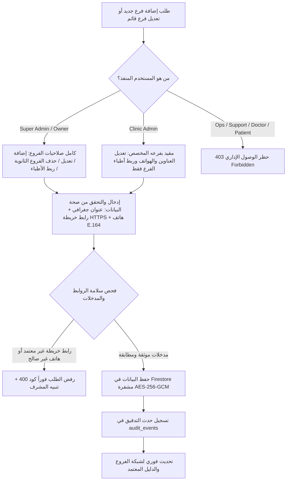

# 🏥 خطوات العمل القياسية لإدارة المراكز الطبية والفروع والأطباء
## (Branches & Clinics Manager Standard Operating Procedures — SOP-OPS-035)

**كود الوثيقة:** `SOP-OPS-035`  
**تاريخ الإصدار:** 22 أكتوبر 2026  
**الإصدار:** v2.4 (Practo Global Benchmark)  
**الفئة المستهدفة:** مدراء المنظومة (Super Admins)، مدراء الفروع والعيادات (Clinic Admins)، فريق العمليات (Operations / Ops)، فريق دعم المرضى والعملاء (Support)، وفريق الجودة والامتثال الطبي (QA & Compliance).

---

## 1. الغرض ونطاق التطبيق (Purpose & Scope)

تهدف هذه الوثيقة القياسية إلى تحديد وتوحيد إجراءات العمل التشغيلية لإدارة شبكة المراكز الطبية والمستشفيات والعيادات التخصصية والفروع الافتراضية (Telehealth Branches) على منصة **Health Vibe AI**.  
تضمن هذه الإجراءات:
1. تسجيل وتحديث بيانات الفروع بدقة فائقة وعناوين خرائط معتمدة دولياً ومحمية.
2. إدارة انتسابات الأطباء الاستشاريين والأخصائيين وتوزيع السعة الاستيعابية للفروع.
3. التطبيق الصارم لمبدأ الحد الأدنى من الصلاحيات (Least Privilege) والعزل الجغرافي والإداري التام بين الفروع (Multi-Tenant Branch Isolation).
4. الحظر المطلق لتسرب أي بيانات صحية أو سريرية للمرضى (Zero-PHI Leakage) خارج نطاق الفرع المصرح به.
5. توثيق وتسجيل كافة العمليات التعديلية في سجلات التدقيق الأمني والقانوني (Audit Trail).

---

## 2. مخطط مسار العمليات التشغيلية (Operational Workflow Diagram)

---

## 3. إجراءات العمل القياسية التفصيلية (Step-by-Step SOPs)

### SOP-01: تسجيل وإضافة مركز طبي أو فرع جديد (New Branch Onboarding)
* **المسؤول الحصري:** المدير العام / مالك المنظومة (`super_admin` / `isOwner: true`).
* **الهدف:** إدراج مستشفى أو مركز طبي جديد في الشبكة المعتمدة.

#### خطوات التنفيذ:
1. التوجه إلى لوحة الإدارة العامة والنقر على **إدارة العيادات والمستشفيات والفروع (Branches & Clinics Manager)**.
2. النقر على زر **`+ إضافة فرع / مركز طبي جديد`**.
3. استيفاء حقول البيانات الإلزامية:
   - **معرف الفرع (`Branch ID`):** معرف فريد باللغة الإنجليزية بدون مسافات (مثال: `clinic_nasr_city`, `clinic_sheikh_zayed`).
   - **اسم المنشأة بالعربية والإنجليزية:** (مثال: `مستشفى هيلث فايب الدولي — فرع مدينة نصر` / `HealthVibe International — Nasr City Branch`).
   - **المحافظة / المدينة:** اختيار المدينة بدقة (القاهرة، الجيزة، الإسكندرية، أسيوط...).
   - **العنوان التفصيلي:** كتابة العنوان باللغتين مع المعالم البارزة وأقرب محطة مترو أو مواصلات.
   - **رقم الهاتف المباشر:** إدخال رقم الطوارئ والاستقبال بالصيغة الدولية E.164 (مثال: `+20 2 2275 1111`).
   - **رابط الموقع على الخريطة (Secure Map URL):** رابط مشفر HTTPS لمزود موثوق حصراً:
     * `https://maps.google.com/?q=LAT,LNG`
     * `https://goo.gl/maps/CODE`
     * `https://www.openstreetmap.org/#map=...`
     * `https://waze.com/ul?ll=LAT,LNG`
   - **التخصصات الطبية النشطة:** تحديد التخصصات المتوفرة بالفرع (الصدر، الباطنة، الحساسية، الأطفال...).
   - **طاقة الأطباء الاستيعابية (`Doctors Capacity`):** عدد العيادات المجهزة في الفرع.
4. مراجعة إقرار التحقق والنقر على **حفظ واعتماد الفرع**.
5. يقوم النظام بالتحقق الآلي وتسجيل حدث التدقيق `CLINIC_BRANCH_CREATED`.

---

### SOP-02: تحديث بيانات الفرع والعناوين وأرقام التواصل (Branch Updates)
* **المسؤول:** مدير الفرع المعتمد (`clinic_admin`) لفرعه فقط، أو المدير العام (`super_admin`) لكافة الفروع.
* **الهدف:** إبقاء عناوين الفروع، الخرائط المحدثة، وأرقام الطوارئ مطابقة للواقع الجغرافي.

#### خطوات التنفيذ:
1. فتح بطاقة الفرع المطلوب من جدول الفروع والنقر على **`تعديل بيانات الفرع (Edit Branch)`**.
2. تعديل الحقول المطلوبة (رقم الهاتف، رابط الخريطة الجديد، مواعيد العمل).
3. **ضوابط الأمان الإلزامية أثناء التعديل:**
   - يُمنع إدخال أي وسوم برمجية أو أكواد HTML في العنوان (يقوم النظام بالتطهير التلقائي `sanitizeBranchText`).
   - لا يمكن لمدير الفرع تعديل معرف الفرع الأساسي أو تغيير صفة الفرع من فرعي إلى مقر رئيسي.
4. النقر على **`حفظ التعديلات`**.
5. يتم توثيق العملية فوراً بحدث `CLINIC_BRANCH_UPDATED` متضمناً معرّف المشرف، وتفاصيل الحقول المعدلة.

---

### SOP-03: إدارة انتسابات الأطباء وتوزيع الكوادر الطبية (Doctor Branch Affiliation)
* **المسؤول:** مدير الفرع (`clinic_admin`) أو المدير العام (`super_admin`).
* **الهدف:** ربط الأطباء المعتمدين بالفروع وتحديد صفتهم السريرية لتمكين حجز المواعيد وتنظيم الحضور.

#### أ. إجراء ربط طبيب جديد بالفرع (Link Doctor):
1. الانتقال إلى تبويب **الأطباء التابعين للفرع (Affiliated Doctors)** في لوحة إدارة الفرع.
2. النقر على **`ربط طبيب معتمد بالفرع`**.
3. اختيار الطبيب من قائمة الأطباء المعتمدين والموثقين ترخيصاً بالمنصة (بحث بالاسم أو التخصص).
4. تحديد الصفة السريرية في الفرع:
   - `senior_consultant` (استشاري أول / رئيس قسم)
   - `consultant` (استشاري)
   - `specialist` (أخصائي)
   - `visiting_professor` (أستاذ زائر)
5. النقر على **تأكيد الربط**.
6. يتم تحديث ملف الطبيب فوراً بإضافة عضوية الفرع النشطة (`clinicMemberships: status: approved`) وتوثيق حدث `CLINIC_DOCTORS_UPDATED`.

#### ب. إجراء فك ارتباط الطبيب (Unlink / Revoke Doctor):
1. في حال انتهاء تعاقد الطبيب أو انتقاله، يتم النقر على أيقونة **`إلغاء الانتساب (Unlink)`** بجانب اسم الطبيب.
2. تأكيد الإجراء مع ذكر السبب الإداري.
3. يتم إيقاف حجز المواعيد الجديدة للطبيب في هذا الفرع فوراً وتحويل حالته إلى `revoked`، مع بقاء سجلاته الطبية السابقة مؤرشفة ومحمية.

---

### SOP-04: إجراءات حماية المقر الرئيسي وحذف الفروع الثانوية (Headquarters Safeguard & Branch Deletion)
* **المسؤول:** المدير العام فقط (`super_admin`).
* **الهدف:** منع الحذف الخاطئ أو المتعمد للمنشآت الحيوية وتنظيم إغلاق الفروع الثانوية.

#### أ. حماية المقر الرئيسي (Primary Headquarters):
- الفرع الأساسي للشبكة (`clinic_cairo_main`) مُحصن برمجياً على مستوى السيرفر وقواعد البيانات (`isPrimary: true`).
- في حال محاولة حذفه، يرفض النظام العملية نهائياً بكود خطأ:
  `400 CANNOT_DELETE_PRIMARY_BRANCH: The primary headquarters branch cannot be deleted from the network.`

#### ب. حذف فرع ثانوي غير نشط:
1. التحقق من عدم وجود مواعيد مستقبلية محجوزة للمرضى في الفرع (إعادة توجيهها أو تسويتها).
2. فك ارتباط كافة الأطباء التابعين للفرع.
3. التوجه للفرع والنقر على **`حذف الفرع من الشبكة (Delete Branch)`**.
4. تأكيد عملية الحذف مع إدخال كلمة المرور التأكيدية للمدير العام.
5. يسجل النظام حدث `CLINIC_BRANCH_DELETED` ويتم أرشفة الفرع نهائياً.

---

### SOP-05: دعم المرضى واستفسارات الفروع (Customer Support & Patient Routing SOP)
* **المسؤول:** موظف خدمة العملاء ودعم المرضى (`support`).
* **الهدف:** توجيه المرضى ومساعدتهم في الوصول السريع للفروع وحجز التخصص المناسب.

#### خطوات العمل:
1. عند تلقي اتصال أو تذكرة استفسار عن موقع فرع أو أطباء متاحين:
   - يفتح موظف الدعم دليل الفروع المعتمد.
   - يستعلم عن المدينة والحي السكني للمريض لتحديد أقرب فرع جغرافي.
2. مشاركة رابط الملاحة المعتمد (Google Maps / Waze) عبر الرسائل المعتمدة أو تطبيق WhatsApp للمنصة.
3. **الامتثال التام للخصوصية (Zero-PHI Rule):**
   - يُحظر على موظف الدعم التطلع إلى أو مناقشة التاريخ المرضي للمريض عبر تذاكر الفروع.
   - بيانات الأطباء في الدليل تتضمن الاسم والتخصص والبريد المموه (`t***k@healthvibes.org`) فقط؛ ويمنع منعاً باتاً طلب أو إفشاء أي أرقام هواتف خاصة أو بطاقات رقم قومي للأطباء.
4. في الحالات التنفسية الطارئة، يتم توجيه المريض فوراً للمستشفيات الرئيسية المجهزة بوحدات عناية مركزة وأكسجين، مع تفعيل بروتوكول الطوارئ.

---

### SOP-06: الاستجابة للحوادث الأمنية ومحاولات تسرب البيانات (Security Incident Protocol)
* **المسؤول:** مسؤولو الأمان والامتثال (Security & Legal / Super Admin).
* **الهدف:** معالجة فورية لأي محاولة انتهاك لحدود الفروع المشتركة (Cross-Clinic Violation).

#### سيناريو المخالفة وإجراءات الرد:
1. عند قيام مدير فرع (`clinic_admin`) بمحاولة فحص أو استعلام سجلات مرضى فرع آخر:
   - يقوم جدار حماية السيرفر (`GET /api/admin/clinics/:clinicId/patients`) بحظر الطلب فوراً برمز:
     `403 CROSS_CLINIC_LEAKAGE_PROHIBITED`
   - يُطلق النظام تلقائياً تنبيهاً أمنياً ويسجل حدث التدقيق:
     `CROSS_CLINIC_LEAKAGE_ATTEMPT_BLOCKED`
2. **بروتوكول التحقيق (Investigation Protocol):**
   - فتح سجل أحداث التدقيق واستخراج بيانات الحادثة:
     * مُعرّف المستخدم المنفذ (`actorUid`) والبريد الإلكتروني.
     * الفرع التابع له والفرع المستهدف بالهجوم.
     * الطابع الزمني للعملية وعنوان الـ IP.
3. اتخاذ الإجراء التأديبي وفق لائحة الحوكمة:
   - توجيه إنذار أمني أول في حال الخطأ غير المقصود.
   - في حال تكرار المحاولة، يتم تجميد حساب مدير الفرع فوراً (`Suspend Account`) وفتح تحقيق إداري وقانوني لمخالفة قانون حماية البيانات الشخصية.

---

## 4. مصفوفة المسؤوليات (RACI Matrix)

| العملية التشغيلية | Super Admin | Clinic Admin | Ops Team | Support Team | QA & Compliance |
| :--- | :---: | :---: | :---: | :---: | :---: |
| **إضافة مركز طبي / مستشفى جديد** | **A / R** | I | C | I | C |
| **تحديث عناوين وهواتف الفرع المخصص** | A | **R** | I | I | C |
| **ربط وفك ارتباط الأطباء بالفروع** | A | **R** | I | I | C |
| **حذف فرع ثانوي بعد انتهاء نشاطه** | **A / R** | C | I | I | C |
| **توجيه المرضى ومشاركة خرائط الفروع** | I | I | I | **A / R** | I |
| **التحقيق في محاولات تسرب البيانات** | **A** | I | C | I | **R** |

*المفاتيح: **R** = Responsible (المسؤول عن التنفيذ)، **A** = Accountable (المسؤول النهائي/صاحب القرار)، **C** = Consulted (يُستشار)، **I** = Informed (يُخطر).*

---

## 5. قائمة الفحص الدورية للامتثال والجودة (Quality & Audit Checklist)

يتم تنفيذ هذه المراجعة أسبوعياً بواسطة فريق الجودة والامتثال الطبي للتأكد من انضباط المنظومة:

- [ ] **صلاحية روابط الخرائط:** التأكد من أن جميع الروابط تعمل عبر `https://` وتفتح المواقع الصحيحة بدقة في مدن ومحافظات مصر.
- [ ] **صلاحية أرقام الهواتف:** فحص دوري بالاتصال بأرقام الاستقبال والطوارئ المسجلة للفروع والتأكد من استجابتها وسرعة الرد.
- [ ] **مطابقة الأطباء الفعليين:** مطابقة قائمة الأطباء المنتسبين لكل فرع مع كشوف العمليات والمناوبات بالمستشفى.
- [ ] **فحص سجلات التدقيق (Audit Logs):** مراجعة سجلات `audit_events` والتأكد من عدم وجود محاولات غير مصرح بها أو أنشطة مشبوهة لتعديل الفروع.
- [ ] **التحقق من حظر تسرب البيانات (Zero-PHI Check):** إجراء مسح أمني دوري للتأكد من عدم ظهور أي بيانات تشخيصية أو سريرية في واجهات استعراض الفروع للموظفين غير المصرح لهم.
- [ ] **جاهزية الطوارئ:** التحقق من تحديث أرقام الخطوط الساخنة (Hotlines) وتوافر معلومات إسعاف الحالات التنفسية الحرجة.

---

**اعتماد الوثيقة:**  
- **رئيس قطاع التشغيل والعمليات (Head of Operations):** د. طارق السعدني — *معتمد*  
- **مسؤول حماية البيانات والأمان (CISO & Legal Officer):** م. بدر أحمد — *معتمد*  
- **المرجع المعياري:** Practo Global Hospital & Clinic Management Guidelines v4.2
