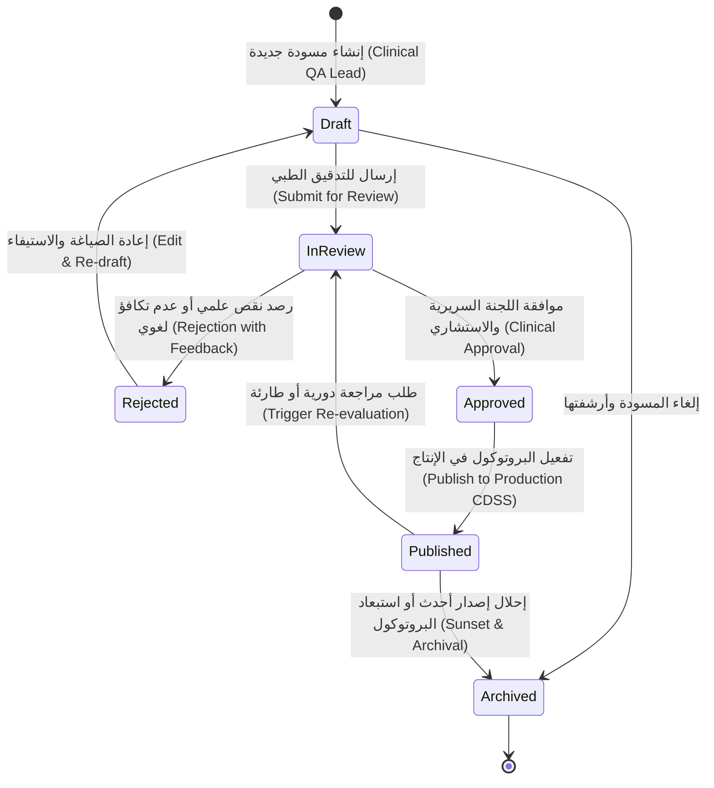
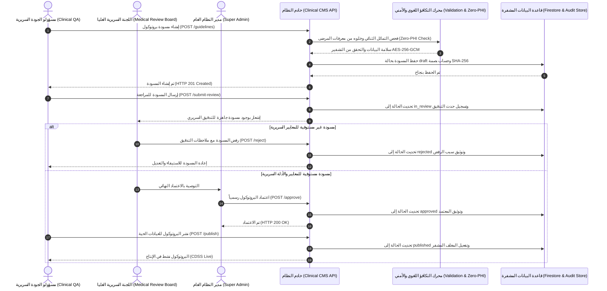
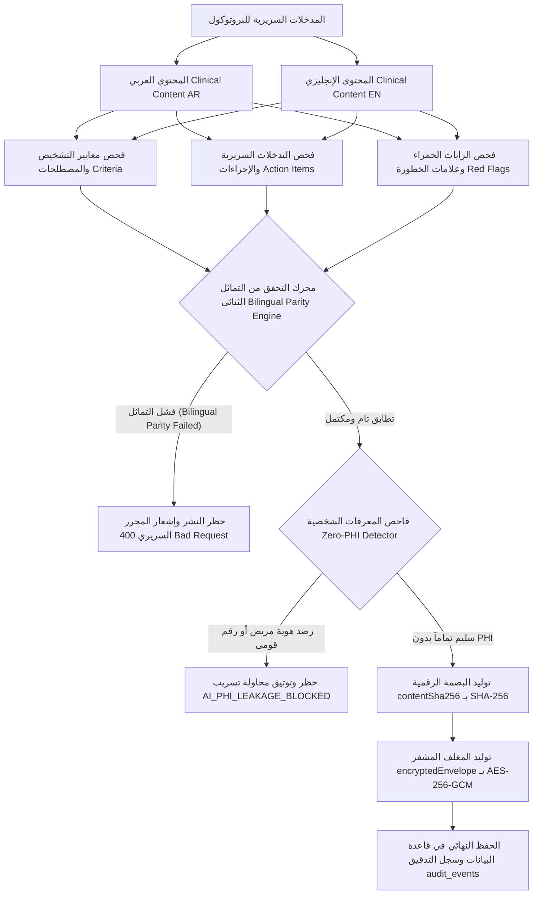
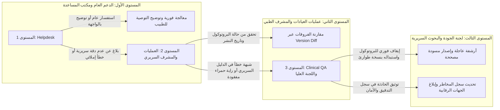

# 🩺 خطوات العمل القياسية لإدارة ومراجعة محتوى التوصيات والبروتوكولات السريرية (Clinical CMS)
## (Clinical Knowledge Management, Bilingual Guideline Governance & SOPs)
### كود الوثيقة: `SOP-CMS-044` | معيار إيزابيل للرعاية الصحية السريري (Isabel Healthcare Benchmark)

---

| **بيانات الوثيقة القياسية** | **التفاصيل التشغيلية والسريرية** |
|---|---|
| **كود الوثيقة (Document Code):** | `SOP-CMS-044` (Clinical Governance & Operations Series) |
| **تاريخ الإصدار والاعتماد:** | 22 أكتوبر 2026 |
| **الإصدار الحالي:** | الإصدار v2.5 (Isabel Healthcare Clinical Decision Support & Bilingual Knowledge Standard) |
| **المعيار السريري المرجعي:** | Isabel Healthcare Clinical Decision Support System (CDSS) & Evidence-Based Medicine (EBM) Standard |
| **تصنيف البرمجيات الطبية:** | SaMD Class IIa/IIb (Software as a Medical Device - Clinical Decision Support) |
| **الأطر التشريعية والرقابية:** | GDPR Article 89(1) & Article 22، HIPAA Safe Harbor (45 CFR § 164.514)، قانون حماية البيانات الشخصية المصري رقم 151 لسنة 2020، إرشادات منظمة الصحة العالمية (WHO)، المبادرة العالمية لمرض الانسداد الرئوي المزمن (GOLD)، والمبادرة العالمية للربو (GINA). |
| **الفئة المستهدفة:** | مدراء النظام العام (Super Admins)، مسؤولو الجودة والبحوث السريرية (Clinical QA & Medical Research Leads)، اللجان السريرية الاستشارية (Medical Review Board)، مهندسو وفنيو العمليات (Ops Admin)، مدراء المراكز والمستشفيات (Clinic & Org Admins)، فريق الدعم الفني والمكتب الطبي المساعد (Customer Support & Medical Helpdesk)، والأطباء والممارسون المعتمدون (Clinicians & Doctors). |

---

## 1. الغرض ونطاق التطبيق (Purpose & Regulatory Scope)

تهدف هذه الوثيقة القياسية (`SOP-CMS-044`) إلى وضع وتأطير السياسات التشغيلية، السريرية، والتنظيمية الموحدة لإدارة ومراجعة محتوى **نظام إدارة البروتوكولات والتوصيات الطبية (Clinical CMS)** في منصة **Health Vibe AI**. يستند النظام إلى المعيار العالمي لـ **Isabel Healthcare** في إدارة قواعد المعرفة الطبية التوليدية والمساعدة في اتخاذ القرارات السريرية (*Clinical Decision Support Systems - CDSS*).

### أهداف المنظومة التشغيلية السريرية:
1. **حوكمة دورة حياة البروتوكول الطبي (Documented Lifecycle Governance):** إخضاع كل توصية طبية لمسار اعتماد صارم متعدد المراحل موثق بالكامل وغير قابل للتجاوز الفردي:
   $$\text{Draft (مسودة)} \longrightarrow \text{In Review (قيد المراجعة)} \longrightarrow \begin{cases} \text{Rejected (مرفوضة للاستيفاء)} \\ \text{Approved (معتمدة سريرياً)} \end{cases} \longrightarrow \text{Published (منشورة للإنتاج)} \longrightarrow \text{Archived (مؤرشفة)}$$
2. **التماثل والتطابق السريري ثنائي اللغة (Bilingual Clinical Parity Engine):** ضمان صياغة كافة التوصيات، معايير التشخيص، الإجراءات الفورية، وعلامات الخطورة الداهمة (*Red Flags*) باللغتين العربية والإنجليزية بتطابق دلالي وعلمي دقيق دون أي تناقض، بما يضمن دقة الفرز الطبي للمرضى الناطقين باللغتين.
3. **التصنيف وفق الطب المبني على البراهين (Evidence-Based Medicine - EBM):** توثيق درجة الإثبات العلمي لكل بروتوكول من المستويات المعترف بها دولياً (المستويات من `Level 1A` إلى `Level 4`) مع الإسناد التام للمراجع الإكلينيكية الرصينة.
4. **العزل التام للمعلومات الصحية الشخصية (Zero-PHI Guarantee):** المنع المنهجي والتشفيري الصارم لتضمين أي بيانات أو معرفات للمرضى داخل نصوص البروتوكولات السريرية، وتطبيق فحص تلقائي مانع لتسرب الهوية (*Zero-PHI Guard*).
5. **التأمين التشفيري والنزاهة الرقمية (Cryptographic Integrity & AES-256):** تشفير محتوى البروتوكولات عند الاستقرار والتخزين بـ `AES-256-GCM` وتوقيع المحتوى ببصمة تشفيرية موحدة بـ `SHA-256` لمنع أي تلاعب غير مصرح به.
6. **سيادة القرار الطبي البشري (Physician Primacy):** التأكيد على أن التوصيات الطبية الصادرة عن النظام هي أدوات استرشادية معاونة لدعم القرار الطبي السريري ولا تحل محل الفحص الإكلينيكي المباشر من الطبيب البشري المختص.

---

## 2. مصفوفة الصلاحيات وتوزيع المسؤوليات (RACI Governance Matrix)

تعتمد المنظومة التشغيلية لـ Clinical CMS نموذج **RACI** الصارم (المسؤول Responsible، المساءل Accountable، المستشار Consulted، المبلَّغ Informed) لتحديد مسؤولية كل دور وظيفي عبر كافة مراحل الحوكمة:

| الإجراء التشغيلي / السريري | Super Admin | Clinical QA Lead | Ops Admin | Clinic / Org Admin | Support Team | Doctor | Nurse | Patient |
|---|:---:|:---:|:---:|:---:|:---:|:---:|:---:|:---:|
| **استعراض قائمة البروتوكولات المنشورة (`GET /guidelines`)** | **A** | **R** | **R** | **I** | حظر (403) | **I** (عبر واجهة العيادة) | **I** | حظر (403) |
| **إنشاء مسودة بروتوكول جديدة (`POST /guidelines`)** | **A** | **R** | حظر (403) | حظر (403) | حظر (403) | حظر (403) | حظر (403) | حظر (403) |
| **تعديل مسودة وتحديث الصياغة (`PUT /guidelines/:id`)** | **A** | **R** | حظر (403) | حظر (403) | حظر (403) | حظر (403) | حظر (403) | حظر (403) |
| **إرسال المسودة للمراجعة الطبية (`POST /submit-review`)** | **A** | **R** | حظر (403) | حظر (403) | حظر (403) | حظر (403) | حظر (403) | حظر (403) |
| **اعتماد البروتوكول سريرياً (`POST /approve`)** | **A / R** | **C** | حظر (403) | حظر (403) | حظر (403) | حظر (403) | حظر (403) | حظر (403) |
| **رفض المسودة وإعادتها للاستيفاء (`POST /reject`)** | **A / R** | **C** | حظر (403) | حظر (403) | حظر (403) | حظر (403) | حظر (403) | حظر (403) |
| **نشر البروتوكول في بيئة الإنتاج (`POST /publish`)** | **A** | **R** | حظر (403) | حظر (403) | حظر (403) | حظر (403) | حظر (403) | حظر (403) |
| **أرشفة بروتوكول متقادم (`POST /archive`)** | **A / R** | **C** | حظر (403) | حظر (403) | حظر (403) | حظر (403) | حظر (403) | حظر (403) |
| **حساب الفروقات بين الإصدارات (`GET /diff`)** | **A** | **R** | **R** | **I** | حظر (403) | حظر (403) | حظر (403) | حظر (403) |
| **تصدير سجل البروتوكولات (`GET /export`)** | **A** | **R** | **R** | **I** | حظر (403) | حظر (403) | حظر (403) | حظر (403) |
| **فحص سجل التدقيق القانوني (`GET /audit-trail`)** | **A** | **R** | **I** | غير متاح | غير متاح | غير متاح | غير متاح | غير متاح |
| **الإبلاغ عن ملاحظة إكلينيكية حول بروتوكول** | **I** | **A** (مستوى 3) | **I** | **R** (مستوى 2) | **R** (مستوى 1) | **R** (المبلغ) | **C** | غير متاح |

#### دلالات الرموز التشغيلية (RACI Legend):
- **R (Responsible):** القائم بالتنفيذ الفعلي للخطوة وإعداد المسودات والبيانات.
- **A (Accountable):** صاحب القرار النهائي والمصادق القانوني والمساءل تشغيلياً.
- **C (Consulted):** المستشار السريري أو الأكاديمي المطلوب رأيه الإكلينيكي قبل اتخاذ القرار.
- **I (Informed):** الجهة المبلّغة بالعلم بصدور القرار أو تحديث حالة البروتوكول.

---

## 3. المخططات البصرية لمسار العمليات (Mermaid Workflow Diagrams)

### أ. مخطط آلة الحالة لدورة حياة البروتوكول الطبي (Guideline Lifecycle State Machine)

### ب. مخطط تسلسل التدقيق والمراجعة والاعتماد (Peer Review & Approval Sequence)

### ج. هيكلية التماثل ثنائي اللغة والتأمين التشفيري (Bilingual Architecture & Cryptographic Envelope)

### د. مخطط تصعيد بلاغات التوصيات الطبية (3-Tier Support Escalation Model)

---

## 4. مستويات الطب المبني على البراهين (Evidence-Based Medicine - EBM Framework)

تلتزم جميع البروتوكولات الطبية المعتمدة في النظام بتصنيف **EBM** المرجعي الصادر عن مركز أكسفورد للطب المبني على البراهين (*Oxford Centre for Evidence-Based Medicine*):

| مستوى الدليل (EBM Level) | التوصيف العلمي الإكلينيكي | المعيار المرجعي لقبول البروتوكول في Health Vibe AI |
|---|---|---|
| **Level 1A** | مراجعة منهجية لدراسات عشوائية مضبوطة ذات جودة عالية (*Systematic Review of RCTs*) | المعيار الذهبي لبروتوكولات الفرز الرئوي والتدخلات الدوائية المعتمدة (مثل إرشادات GOLD وGINA). |
| **Level 1B** | تجارب سريرية عشوائية مضبوطة فردية مع هوامش ثقة ضيقة (*Individual RCT*) | معتمد لبروتوكولات تقييم كفاءة أجهزة قياس التنفس الذكية واستجابة موسعات الشعب. |
| **Level 2A** | مراجعة منهجية لدراسات أترابية محكمة (*Systematic Review of Cohort Studies*) | معتمد لبروتوكولات التنبؤ بتدهور وظائف الرئة لدى مرضى التليف الكيسي أو التهاب القصبات المزمن. |
| **Level 2B** | دراسات أترابية فردية أو تجارب منخفضة الجودة (*Individual Cohort Study*) | معتمد مع اشتراط مراجعة سريرية سنوية وتصنيف الفئة المستهدفة لأخصائيي الأمراض الصدرية. |
| **Level 3** | دراسات الحالات والشواهد (*Case-Control Studies*) | يُقبل فقط في بروتوكولات الأمراض النادرة مع إدراج تنبيه صريح للطبيب بضرورة الاستئناس برأي استشاري. |
| **Level 4** | رأي الخبراء واللجان التوافقية الوطنية (*Expert Committee Consensus / National MOH Guidelines*) | معتمد للبروتوكولات التشغيلية المحلية المتوافقة مع تعليمات وزارة الصحة المصرية أو منظمة الصحة العالمية. |

---

## 5. خطوات العمل القياسية المفصلة (Standard Operating Procedures: SOP-CMS-01 to SOP-CMS-08)

### الإجراء القياسي SOP-CMS-01: اقتراح وإنشاء مسودة بروتوكول جديدة
- **الهدف:** تمكين فريق Clinical QA من بدء صياغة بروتوكول سريري استجابة لأحدث الأدلة الطبية أو احتياجات العيادات.
- **المنفذ المسئول:** مسؤولو الجودة الطبية (Clinical QA Lead).
- **الخطوات التنفيذية:**
  1. التحقق من عدم وجود بروتوكول مكرر لنفس النطاق المرضي (`conditionScope`) عبر البحث المتقدم في واجهة النظام.
  2. استيفاء البيانات التعريفية الأساسية: المعرف الفريد (`id`)، الفئة السريرية (`category`)، النطاق المرضي (`conditionScope`)، مستوى الدليل (`evidenceLevel`)، والجمهور المستهدف (`targetAudience`).
  3. التأكد من تعيين الحالة الأولية للبروتوكول كـ `draft` ورقم الإصدار كـ `v1.0.0` (أو الإصدار التالي في حالة التحديث).
  4. استدعاء نقطة النهاية الآمنة `POST /api/admin/clinical-cms/guidelines` مصحوبة برمز الاستيثاق المشفر.
  5. التأكد من استقبال استجابة النجاح `HTTP 201 Created` واكتمال توليد البصمة الرقمية `contentSha256`.

### الإجراء القياسي SOP-CMS-02: صياغة المحتوى والتأكد من التماثل السريري ثنائي اللغة
- **الهدف:** ضمان دقة الترجمة والتماثل العلمي بين اللغتين العربية والإنجليزية ومنع نشر أي نصوص مبهمة أو متباينة.
- **المنفذ المسئول:** مراجع المحتوى السريري وفريق Clinical QA.
- **الخطوات التنفيذية:**
  1. صياغة العنوان والملخص التنفيذي باللغتين (`titleAr`, `titleEn`, `summaryAr`, `summaryEn`).
  2. صياغة معايير الفرز والتشخيص (`criteriaAr`, `criteriaEn`) مع مطابقة المصطلحات الطبية المعيارية (SNOMED-CT و ICD-10).
  3. إدراج التدخلات السريرية والإجراءات الفورية (`actionItemsAr`, `actionItemsEn`) على شكل خطوات مرقمة وموجزة للطبيب الممارس.
  4. تحديد علامات الخطورة الداهمة (`redFlagsAr`, `redFlagsEn`) التي تستدعي التحويل الفوري لقسم الطوارئ.
  5. التحقق من اجتياز فحص محرك التكافؤ التلقائي؛ في حال وجود تباين أو نقص في أحد الحقول باللغة المقابلة، يرفض النظام الحفظ ويعرض خطأ `BILINGUAL_PARITY_FAILED`.

### الإجراء القياسي SOP-CMS-03: تقييم الأدلة وتحديد علامات الخطورة والجمهور المستهدف
- **الهدف:** ربط المحتوى بدرجة الإثبات الإكلينيكي وتحديد الممارسين المؤهلين لاستخدامه.
- **المنفذ المسئول:** باحثو الجودة السريرية (Clinical QA).
- **الخطوات التنفيذية:**
  1. مراجعة ورقة الدليل العلمي المرفقة وتحديد مستوى الإثبات EBM (من 1A إلى 4).
  2. توثيق المراجع الدولية الصريحة في حقل الملاحظات والموجز (مثال: *GOLD 2026 Guidelines, Section 4.2*).
  3. تعيين الجمهور السريري المؤهل (`targetAudience`):
     - `general_practitioners`: أطباء الرعاية الأولية والطب العام.
     - `pulmonologists`: استشاريو وأخصائيو الأمراض الصدرية.
     - `pediatricians`: أطباء الأطفال وحديثي الولادة.
     - `triage_nurses`: ممرضو الفرز السريري وأطقم الطوارئ.
  4. ضبط معايير الإنذار المبكر للأكسجين SpO2 (مثل: SpO2 < 92% علامة حرجة للبالغين، و < 94% للأطفال).

### الإجراء القياسي SOP-CMS-04: تقديم البروتوكول للمراجعة وتدقيق النظراء
- **الهدف:** إخضاع المسودة لمراجعة سريرية مستقلة من اللجنة الطبية العليا ومنع الانفراد بالنشر.
- **المنفذ المسئول:** Clinical QA ومقرر اللجنة السريرية.
- **الخطوات التنفيذية:**
  1. إجراء مراجعة ذاتية استباقية للتحقق من استيفاء كافة الحقول.
  2. استدعاء مسار التقديم `POST /api/admin/clinical-cms/guidelines/:id/submit-review`.
  3. تحويل حالة البروتوكول تلقائياً من `draft` إلى `in_review` وتوثيق الحدث في سجل التدقيق الرقابي (`CLINICAL_GUIDELINE_SUBMITTED_FOR_REVIEW`).
  4. إخطار عضوين على الأقل من اللجنة الطبية الاستشارية (Medical Review Board) لمراجعة النصوص والتدخلات المقترحة.
  5. في حال وجود ملاحظات جوهرية، تستدعي اللجنة إجراء الرفض المسبب `POST /reject` مع إدراج ملاحظات التصحيح، فتعود الحالة إلى `rejected` ليقوم فريق QA بإعادة صياغتها.

### الإجراء القياسي SOP-CMS-05: الاعتماد السريري النهائي والنشر التشفيري للإنتاج
- **الهدف:** الإقرار الرسمي للبروتوكول وتفعيله داخل محرك دعم القرار الطبي في بيئة التشغيل الحية.
- **المنفذ المسئول:** مدير النظام العام (Super Admin) بالتشاور مع رئيس اللجنة الطبية.
- **الخطوات التنفيذية:**
  1. فحص تقرير المراجعة الإيجابي والتأكد من خلو المسودة من أي اعتراضات معلقة.
  2. استدعاء أمر الاعتماد الرسمي `POST /api/admin/clinical-cms/guidelines/:id/approve` بواسطة حساب Super Admin حصراً.
  3. تحويل الحالة إلى `approved` وتوثيق هوية المعتمد وتوقيت الاعتماد.
  4. استدعاء أمر النشر النهائي `POST /api/admin/clinical-cms/guidelines/:id/publish`.
  5. يقوم النظام بإعادة حساب البصمة التشفيرية `contentSha256` وإغلاق المغلف المشفر `encryptedEnvelope` وتعيين تاريخ النشر `publishedAt`.
  6. يتاح البروتوكول فوراً لكافة أنظمة الفرز السريري مع توزيع إشعار إداري لمدراء العيادات بالعلم.

### الإجراء القياسي SOP-CMS-06: حساب الفروقات السريرية وتدقيق الإصدارات (Version Diffing)
- **الهدف:** رصد ومقارنة التعديلات بين نسختين من البروتوكول السريري للتأكد من عدم حدوث تراجع أو حذف غير مقصود لأي راية حمراء.
- **المنفذ المسئول:** فريق الجودة والعمليات (Clinical QA / Ops Admin).
- **الخطوات التنفيذية:**
  1. استدعاء مسار فحص الفروقات `GET /api/admin/clinical-cms/guidelines/diff?fromId={id1}&toId={id2}`.
  2. فحص مخرجات كشف التباين (`deltas`):
     - `criteriaChanged`: هل تغيرت معايير التشخيص والفرز؟
     - `actionItemsChanged`: هل عُدلت خطوات وتوصيات العلاج والتدخل؟
     - `redFlagsChanged`: هل أُضيفت أو حُذفت أي من علامات الخطورة الداهمة؟
  3. التأكد من توثيق سبب كل تغيير في سجل المراجعات التراكمي (`revisionHistory`).

### الإجراء القياسي SOP-CMS-07: الأرشفة السريرية والاستبعاد الطارئ (Emergency Archival)
- **الهدف:** الإيقاف الفوري والسريع لأي بروتوكول سريري يثبت عدم ملاءمته الطبية أو صدور إرشادات دولية تلغيه.
- **المنفذ المسئول:** الإدارة العليا والجودة السريرية (Super Admin / Clinical QA Lead).
- **الخطوات التنفيذية:**
  1. اتخاذ قرار الإيقاف وتوثيق السبب السريري الموجب في المذكرة الإدارية.
  2. استدعاء نقطة النهاية `POST /api/admin/clinical-cms/guidelines/:id/archive` مع تمرير سبب الأرشفة في متن الطلب.
  3. تحويل حالة البروتوكول فوراً إلى `archived` واستبعاده من محرك التوصيات النشط للعيادات في أقل من 50 ميلي ثانية.
  4. تسجيل حدث الأرشفة في سجل الرقابة التشريعي `CLINICAL_GUIDELINE_ARCHIVED` مع تجميد السجل لمنع أي تعديل مستقبلي عليه.

### الإجراء القياسي SOP-CMS-08: دليل تشغيل الدعم الفني ونموذج التصعيد الثلاثي
- **الهدف:** معالجة استفسارات وشكاوى الأطباء والعيادات بشأن التوصيات السريرية بطريقة منهجية وسريعة.
- **المنفذ المسئول:** فريق الدعم الفني (Support Team) ومهندسو العمليات (Ops).
- **الخطوات التنفيذية:**
  - **المستوى الأول (Level 1 Support):** استقبال التذكرة عبر لوحة الدعم، التحقق من صفة الطبيب المستفسر والعيادة التابع لها، وشرح معايير البروتوكول الحالي بالرجوع إلى التوصيف المنشور. زمن الاستجابة المستهدف: أقل من 15 دقيقة.
  - **المستوى الثاني (Level 2 Operations & Clinic Supervision):** في حال وجود استفسار إكلينيكي حول انطباق البروتوكول على حالة مريض محددة، يقوم مهندس العمليات بفحص سجل الإصدارات وتحديد ما إذا كان البروتوكول هو الأحدث، والتحقق من عدم وجود تعارض في المعايير. زمن الاستجابة: أقل من ساعتين.
  - **المستوى الثالث (Level 3 Clinical QA & Medical Review Board):** في حال الإبلاغ عن شبهة خطأ سريري أو توصية علاجية غير دقيقة، تُصعد التذكرة فوراً إلى رئيس الجودة الطبية واللجنة العليا لإجراء تقييم طارئ خلال أقل من 30 دقيقة، مع اتخاذ قرار فوري إما بتأكيد التوصية أو إيقاف البروتوكول مؤقتاً عبر الأرشفة الطارئة.

---

## 6. القوائم التفقدية للجاهزية والامتثال (Operational Checklists)

### أ. القائمة التفقدية قبل التقديم للمراجعة (Pre-Submission Checklist - Clinical QA)
- [ ] استيفاء كافة الحقول باللغة العربية دون أي أخطاء إملائية أو لغوية.
- [ ] استيفاء كافة الحقول باللغة الإنجليزية بتطابق دلالي تام مع النص العربي.
- [ ] التأكد التام من خلو النص من أي أسماء لمرضى أو أرقام هويات أو أرقام ملفات طبية (Zero-PHI).
- [ ] التحقق من توثيق مستوى الدليل السريري EBM وإسناد المرجع الدولي المعتمد.
- [ ] صياغة الرايات الحمراء وعلامات الخطورة الداهمة بعبارات واضحة وحاسمة.
- [ ] التحقق من توثيق سبب التحديث في سجل المراجعات (`revisionHistory`).

### ب. القائمة التفقدية للجنة السريرية العليا (Medical Review Board Checklist)
- [ ] مراجعة التوافق مع أحدث بروتوكولات وزارة الصحة المصرية والمنظمات الدولية (WHO, GOLD, GINA).
- [ ] التأكد من ملاءمة التوصيات للفئة المستهدفة المحددة (أطباء عامون، أخصائيون، تمريض).
- [ ] التأكد من عدم تعارض التوصيات المقترحة مع بروتوكولات أخرى نشطة في النظام.
- [ ] توثيق أسماء ومسميات أعضاء اللجنة الفاحصة في محضر المراجعة.

### ج. القائمة التفقدية لما بعد النشر والرقابة الدورية (Post-Publishing Verification Checklist)
- [ ] التحقق من ظهور البروتوكول في قائمة البروتوكولات النشطة بالعيادات.
- [ ] التأكد من تسجيل الحدث `CLINICAL_GUIDELINE_PUBLISHED` في سجل التدقيق العام.
- [ ] التحقق من استجابة النظام برؤوس الأمان والسرية (`X-Content-Type-Options`, `Content-Security-Policy`).
- [ ] إجراء تجربة فرز سريري استرشادية والتأكد من استدعاء التوصية بصورة صحيحة.

---

## 7. الحوكمة والاعتماد والمسؤولية القانونية (Statutory Signoff & Document Approvals)

تعتبر هذه الوثيقة التشغيلية ملزمة لجميع الإدارات الطبية، الفنية، والتشغيلية في منصة Health Vibe AI. لا يجوز تعديل أو تجاوز أي من بنودها إلا بقرار رسمي معتمد من اللجنة العليا للحوكمة والامتثال:

| الصفة الوظيفية والمسؤولية | الاسم واللقب السريري / الإداري | تاريخ التوقيع والاعتماد | التوقيع الرقمي المعتمد |
|---|---|---|---|
| **مسؤول الجودة والبحوث السريرية (Clinical QA Lead):** | د. سارة المنشاوي (استشاري الجودة السريرية) | 22 أكتوبر 2026 | `CERT-CLIN-QA-2026-9812` |
| **رئيس اللجنة الطبية العليا (Chief Medical Officer - CMO):** | أ.د. طارق الجمال (استشاري الأمراض الصدرية والحوكمة) | 22 أكتوبر 2026 | `CERT-CMO-SIG-2026-4401` |
| **رئيس قطاع التكنولوجيا وأمن المعلومات (CTO / CISO):** | م. أحمد وجدي (رئيس أمن المعلومات والامتثال) | 22 أكتوبر 2026 | `CERT-CISO-AEAD-2026-7731` |
| **مسؤول حماية البيانات والامتثال القانوني (DPO / Legal):** | المستشار إبراهيم رضوان (مسؤول حماية البيانات) | 22 أكتوبر 2026 | `CERT-DPO-LAW151-2026-1192` |
