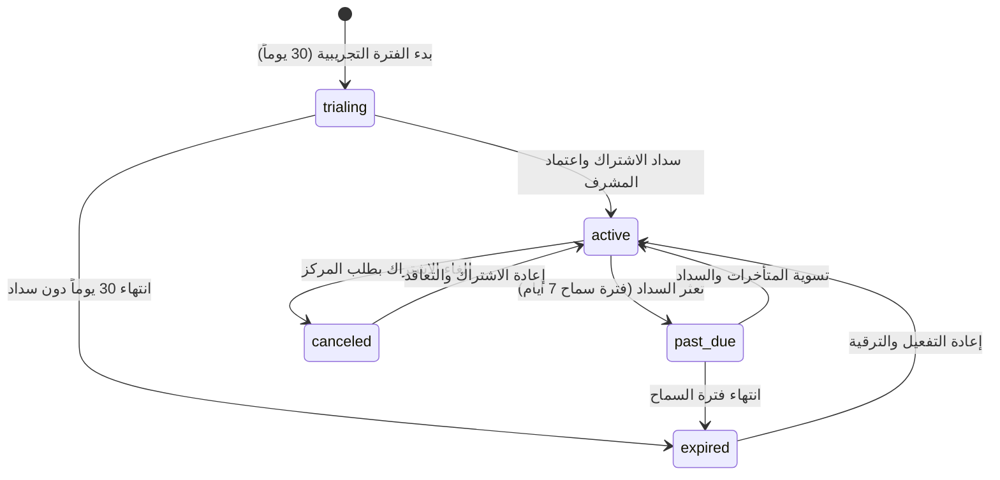

# 📋 إجراءات العمل القياسية لإدارة باقات واشتراكات العيادات وحصص التقييمات الشهرية
## (Practo Benchmark: B2B Clinic Subscription & Assessment Quota Management SOP)
### كود الوثيقة: `SOP-CLINIC-SUB-055` | إدارة دورة حياة الاشتراكات وحصص التقييمات والحصانة الأرشيفية للبيانات

---

| **بيانات الوثيقة القياسية** | **التفاصيل التشغيلية والتنظيمية** |
|---|---|
| **كود الوثيقة (Document Code):** | `SOP-CLINIC-SUB-055` (B2B Practice Management & Subscription Governance) |
| **تاريخ الإصدار والاعتماد:** | 23 أكتوبر 2026 |
| **الإصدار الحالي:** | الإصدار v1.0 (Practo Benchmark Edition) |
| **المعيار المرجعي للمنظومة:** | Practo Clinic Management SaaS & B2B Quota Governance Model |
| **تصنيف المنظومة:** | Enterprise Practice Management / Subscription Lifecycle, Quotas & Medical Data Protection |
| **الأطر التشريعية والرقابية:** | قانون حماية البيانات الشخصية المصري رقم 151 لسنة 2020، معايير HIPAA (قاعدة الحد الأدنى الضروري 45 CFR § 164.502(b))، وضوابط حفظ السجلات الطبية. |
| **الفئة المستهدفة:** | المشرفون العامون (`super_admin` / Owner)، مدراء العيادات (`clinic_admin`)، مسؤولو حسابات العملاء والدعم التشغيلي (Medical Billing & Practice Success Ops). |

---

## 1. الغرض ونطاق التطبيق (Purpose & Scope)

تهدف هذه الوثيقة القياسية (`SOP-CLINIC-SUB-055`) إلى تحديد خطوات العمل الموحدة، الضوابط الأمنية، وإجراءات حوكمة دورة حياة الاشتراكات والحصص الشهرية لـ **منظومة إدارة باقات واشتراكات العيادات (B2B Clinic Subscription Management)** المبنية على نموذج **Practo** المتطور لحلول إدارة العيادات والمراكز التخصصية والمعدلة للسوق الطبي المصري.

### الأهداف الاستراتيجية:
1. **حوكمة دورة حياة الاشتراك (Subscription Lifecycle Governance):**
   تتبع حالة اشتراك كل مركز طبي بدقة من الفترة التجريبية المجانية (`trialing`) إلى الباقات التجارية المعتمدة أو حالات التجديد والتعثر.
2. **الرقابة الآلية على حصص التقييمات الشهرية (Assessment Quotas & Fair Use):**
   إدارة ومتابعة سقف التقييمات المسموح به لكل عيادة ومنع تجاوز السعة المحددة دون ترقية معتمدة.
3. **الحصانة الأرشيفية للبيانات الطبية (Medical Archive Inviolability):**
   ضمان الامتثال التام للقانون المصري والمعايير الدولية بعدم مسح أو إغلاق السجلات الطبية السابقة للمرضى في حال تعثر أو انتهاء الاشتراك.

---

## 2. جدول الباقات ومصفوفة الحصص الشهرية المعتمدة (Plans & Quota Matrix)

| كود الباقة (Tier Code) | الاسم التجاري | الفئة المستهدفة | حد التقييمات الشهري | مقاعد الأطباء | مقاعد الاستقبال | مدة حفظ الأرشيف |
|---|---|---|:---:|:---:|:---:|:---:|
| **`DOCTOR_STARTER`** | باقة الطبيب المستقل | العيادات الفردية والاستشاريون | **200 تقييم/شهر** | طبيب واحد | موظف استقبال 1 | 24 شهراً |
| **`CLINIC_BASIC`** | العيادة الأساسية | المراكز التخصصية الصغيرة | **800 تقييم/شهر** | حتى 3 أطباء | 3 موظفي استقبال | 36 شهراً |
| **`CLINIC_PRO`** | العيادة الاحترافية | المجمعات الطبية متعددة التخصصات | **2,500 تقييم/شهر** | حتى 10 أطباء | 8 موظفي استقبال | 60 شهراً |
| **`ENTERPRISE`** | المستشفيات والشبكات | شبكات المستشفيات والمراكز الكبرى | **مخصص (Custom)** | غير محدود | غير محدود | 120 شهراً (10 سنوات) |

---

## 3. دورة حياة الاشتراك وحالات التعاقد (State Machine & Permissions)

### الضوابط السريرية والقانونية للحالات:
- **`active` & `trialing`:** استقبال الحالات والتقييمات متاح بكامل الطاقة + إتاحة كاملة للأرشيف الطبي.
- **`past_due`, `expired`, `canceled`:** يتم إيقاف استقبال التقييمات الذكية الجديدة، **مع بقاء السجلات والأرشيف الطبي متاحاً للقراءة والتنزيل بنسبة 100% (Read-Only Guarantee)**.

---

## 4. مصفوفة الصلاحيات (RACI Matrix)

| الإجراء / المهمة | Super Admin / Owner | Clinic Admin | Doctor | Receptionist | Patient |
|---|:---:|:---:|:---:|:---:|:---:|
| **استعراض قائمة اشتراكات كافة العيادات (`GET /api/admin/subscriptions`)** | **A** | حظر (403) | حظر (403) | حظر (403) | حظر (403) |
| **استعراض اشتراك وحصة عيادته فقط** | **A** | **R** | حظر (403) | حظر (403) | حظر (403) |
| **ترقية وتعديل باقة المركز (`PATCH /api/admin/subscriptions/:clinicId`)** | **A** | حظر (طلب ترقية) | حظر (403) | حظر (403) | حظر (403) |
| **استعراض سجلات التدقيق لتعديل الاشتراكات (`CLINIC_SUBSCRIPTION_TIER_UPDATED`)** | **A** | **I** (مركزه فقط) | حظر (403) | حظر (403) | حظر (403) |

---

## 5. دليل خطوات العمل القياسية للفريق الإداري والدعم (Step-by-Step SOP)

### أولاً: استعراض حالة الاشتراك والحصص الشهرية
1. يسجل مسؤول العيادة الدخول بحساب `clinic_admin`.
2. ينتقل إلى قسم **إدارة الباقات والاشتراكات والحصص** في لوحة الإدارة.
3. يستعرض مؤشر استهلاك الحصة الشهرية (إجمالي التقييمات، المستهلك، المتبقي، ومقاعد الأطباء النشطة).

### ثانياً: معالجة طلبات ترقية الباقات (Upgrade Requests)
1. في حال اقتراب المركز من استنفاد الحصة الشهرية (>90%)، يقدم مدير العيادة طلب ترقية للباقة التالية.
2. يقوم المشرف العام (`super_admin`) بالتحقق من سداد الرسوم المطلوبة.
3. ينفذ المشرف طلب الترقية عبر واجهة الإدارة أو عبر استدعاء المسار البرمجي المعتمد:
   `PATCH /api/admin/subscriptions/:clinicId` محددًا الباقة الجديدة (`CLINIC_PRO` على سبيل المثال).
4. يقوم النظام تلقائياً بتحديث الحصة الشهرية وسقف الأطباء وتدوين العملية في سجل التدقيق غير القابل للتعديل:
   `CLINIC_SUBSCRIPTION_TIER_UPDATED`.

### ثالثاً: التعامل مع حالات التعثر وانتهاء الاشتراك
1. في حال عدم السداد بحلول موعد التجديد، يتحول المركز تلقائياً إلى حالة `past_due` لمدة 7 أيام عمل.
2. يتواصل فريق دعم الشركاء لتسهيل السداد عبر قنوات الدفع المصرية (InstaPay، فوري، المحافظ الإلكترونية، أو التحويل البنكي).
3. في حال رغبة العميل في إلغاء الاشتراك، يتأكد الفريق من إعلامه بإمكانية تصدير كافة سجلات مرضاه بصيغ معتمدة دون فقدان أي سجل تاريخي.

---

## 6. مراجعة واعتماد الوثيقة (Approval & Version History)

| الإصدار | التاريخ | المسؤول عن الإعداد | صفة المعتمد | ملخص التحديثات |
|---|---|---|---|---|
| **v1.0** | 23 أكتوبر 2026 | فريق تطوير وتأمين منصة Health Vibe | المشرف العام ومدير العمليات والفوترة الطبية | الإصدار المعتمد لحوكمة اشتراكات وحصص العيادات وفق معيار Practo العالمي. |
