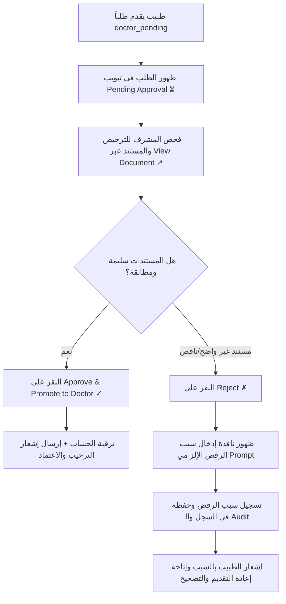

# دليل إجراءات العمل القياسية لمكتب توثيق واعتماد الأطباء (Doctor Verification Desk SOPs)
## Health Vibe AI — Standard Operating Procedures (SOP-VER-024)

تاريخ الإصدار: 2026-10-22  
المرجع المعياري: منصة فيزيتا (Vezeeta Benchmark)، نقابة أطباء مصر، قانون حماية البيانات الشخصية رقم 151 لسنة 2020  
الفئة المستهدفة: مدراء العيادات (Clinic Admins)، الإدارة العامة (Super Admins)، ومسؤولو الامتثال والتحقق

---

## 1. الغرض ونطاق التطبيق (Purpose & Scope)

يحدد هذا الدليل خطوات العمل القياسية والمفصلة لفحص طلبات تسجيل الأطباء الجدد، ومراجعة صور بطاقات الرقم القومي، وتراخيص مزاولة المهنة، وكارنيهات نقابة الأطباء عبر **لوحة مكتب مراجعة وتوثيق الأطباء (Doctor Verification Desk)** لضمان عدم ترقية أي حساب لطبيب معتمد دون التأكد التام من أهليته المهنية والقانونية مع منع أي تسرب لبيانات الهوية أو السجلات السريرية.

---

## 2. مصفوفة المستندات المطلوبة ومعايير القبول (Document Verification Standards)

| المستند المطلوب | الغرض التحققي | معايير القبول والجودة | أسباب الرفض أو التعليق الشائعة |
| :--- | :--- | :--- | :--- |
| **1. كارنيه نقابة الأطباء** | إثبات القيد في جدول نقابة الأطباء الساري | - ساري المفعول للعام الحالي. - وضوح الاسم واللقب المهني (ممارس / أخصائي / استشاري). - وضوح رقم القيد النقابي. | - كارنيه منتهي الصلاحية. - صورة مشوشة أو مقطوعة الأطراف. - عدم تطابق الاسم مع الحساب المسجل. |
| **2. ترخيص مزاولة المهنة** | إثبات التصريح بممارسة الطب من وزارة الصحة | - رقم الترخيص واضح ومقيد رسمياً. - الختم الرسمي للوزارة واضح ومقروء. | - ترخيص مؤقت منتهي. - تلاعب في الأرقام أو التواريخ. |
| **3. بطاقة الرقم القومي** | التحقق من الهوية الشخصية ومطابقة الصور | - وجه وظهر البطاقة سارية المفعول. - تطابق الرقم القومي المكون من 14 رقماً. - توقيع إقرار الموافقة الصريحة للتحقق. | - بطاقة منتهية. - عدم تقديم إقرار الموافقة. - عدم تطابق تاريخ الميلاد أو الرقم. |

---

## 3. خطوات مسار المراجعة الإدارية (Step-by-Step SOP)

### الخطوة 1: الدخول إلى قائمة انتظار الاعتماد (Verification Queue)
1. يسجل المشرف (`clinic_admin` أو `super_admin`) دخوله إلى المنصة ويتوجه لشاشة **لوحة الإدارة (Admin Dashboard)**.
2. يتوجه إلى قسم **قائمة انتظار توثيق واعتماد الأطباء (Admin Verification Queue)**.
3. التصفية التلقائية تفتح على تبويب **`قيد المراجعة (Pending Approval ⏳)`**.

### الخطوة 2: فحص المستندات والتحقق من الهوية
1. مراجعة اسم الطبيب، تخصصه، عيادته المقيدة، ورقم ترخيص النقابة.
2. النقر على رابط **`عرض المستند (View Document ↗)`** لفتح الرابط المشفر المؤقت (Signed URL) وفحص صورة الترخيص وكارنيه النقابة بدقة.
3. مطابقة البيانات مع قاعدة بيانات النقابة الرسمية:
   - التأكد من أن الترخيص ساري وغير مجمد أو ملغى.
   - التأكد من عدم وجود قرارات تأديبية سارية.

### الخطوة 3: اتخاذ القرار الإداري (Decision Protocol)

#### الحالة (أ): اعتماد وترقية الطبيب (Approve Protocol)
- يُتخذ القرار في حال مطابقة كافة المستندات والتراخيص.
- الإجراء:
  1. النقر على زر **`اعتماد وترقية لطبيب موثق ✓ (Approve)`**.
  2. يقوم النظام تلقائياً بتنفيذ الإجراءات التالية في الخلفية:
     - تحديث دور المستخدم إلى `doctor` وتفعيل مطالبة `verifiedDoctor: true`.
     - ربط عضوية الطبيب بالعيادة التابع لها (`clinicMemberships`).
     - جدولة تاريخ التحقق الدوري القادم (`reverificationDueDate`).
     - إبطال التوكنات السابقة وتوليد توكن بصلاحيات الطبيب الجديدة فوراً.
     - تسجيل حدث التدقيق `DOCTOR_APPLICATION_APPROVED` في قاعدة البيانات.

#### الحالة (ب): رفض أو تعليق الطلب مع ذكر السبب (Reject / Suspend Protocol)
- يُتخذ القرار في حال كانت الصور غير واضحة، الترخيص منتهي، أو البيانات غير متطابقة.
- الإجراء:
  1. النقر على زر **`رفض الطلب ✗ (Reject)`**.
  2. يُلزم النظام المشرف بإدخال **سبب الرفض الدقيق** عبر نافذة الإدخال المنبثقة:
     - *أمثلة لصيغ الرفض المعتمدة*:
       - "صورة كارنيه النقابة غير واضحة يرجى إعادة رفع صورة ضوئية عالية الجودة."
       - "ترخيص مزاولة المهنة المرفق منتهي الصلاحية بتاريخ DD/MM/YYYY، يرجى تجديده."
       - "الرقم القومي المدخل لا يطابق الاسم المسجل في بطاقة الرقم القومي المرفقة."
  3. يتم تسجيل `rejectionReason` في قاعدة البيانات وفي سجل التدقيق `audit_events`.
  4. يتحول الطلب إلى تبويب **`المرفوضة (Rejected ✗)`** مع إبراز سبب الرفض في بطاقة الطلب.
  5. يتم إرسال إشعار للطبيب متضمناً سبب الرفض لتمكينه من إعادة رفع المستندات وتصحيحها.

#### الحالة (ج): تعليق الحساب لأسباب مسلكية أو قانونية (Disciplinary Suspension)
- في حال صدور قرار إيقاف من النقابة أو إدارة المستشفى:
  1. يتم التوجه لجدول المستخدمين واستخدام إجراء **`إيقاف (Suspend 🛑)`**.
  2. إدخال سبب الإيقاف الرسمي.
  3. يقوم النظام بتعطيل الحساب فوراً (`isSuspended: true`)، وإبطال جلسة العمل النشطة، ومنعه من توقيع أو اعتماد أي تقارير طبية.

---

## 4. ضوابط الأمان والامتثال والسرية (Security & Privacy Governance)

1. **حظر الوصول غير المصرح به (RBAC Enforcement)**:
   - يُمنع موظفو الدعم الفني (`support`) ومدراء العمليات (`ops`) من الوصول لأزرار الاعتماد أو الرفض أو تعديل صلاحيات الأطباء.
   - مدراء العيادات (`clinic_admin`) مقيدون فقط بالطلبات التابعة لعياداتهم ولا يملكون صلاحية التدخل في عيادات أخرى.
2. **تشفير وحماية صور الهوية (Data Minimization & Encryption)**:
   - تخزين صور البطاقات وكارنيهات النقابة في Storage Buckets خاصة ومحمية بقواعد أمان تمنع القراءة العامة.
   - لا يجوز تنزيل صور البطاقات أو مشاركتها خارج المنظومة التقنية الرسمية تحت طائلة المساءلة القانونية.
3. **التدقيق والمراقبة (Audit Readiness)**:
   - كل عملية اعتماد أو رفض تُخلد باسم المشرف وتاريخها والسبب وتكون جاهزة للتفتيش الدوري من لجان الامتثال الطبي.
