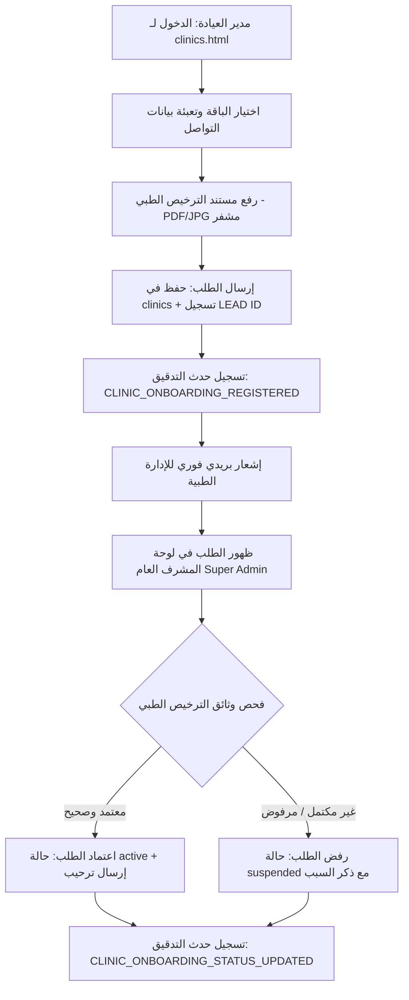

# إجراءات التشغيل القياسية: بوابة انضمام العيادات التفاعلية والتحقق من التراخيص الطبية (Vezeeta Benchmark)
## Standard Operating Procedures: Clinic Interactive Self-Onboarding & Medical License Review

**كود الوثيقة:** SOP-CLINIC-ONBOARD-VEZEETA-001  
**الإصدار:** 1.0  
**التصنيف:** سري للغاية / أمان وتشغيل المراكز الطبية  
**تاريخ التفعيل:** أكتوبر 2026  
**الفريق المسؤول:** فريق التحول السريري، الأمن السيبراني، ومسؤولو النظام (Super Admins)  

---

### 1. الهدف والمجال (Objective & Scope)
تهدف هذه الوثيقة إلى توثيق دورة العمل القياسية لتحويل صفحة العيادات (`app/clinics.html`) إلى بوابة تسجيل ذاتي للمراكز الطبية التخصصية تتيح لمدير المركز اختيار الباقة المناسبة، رفع وثائق السجل التجاري والترخيص الطبي المعتمد، ومراجعتها بدقة وأمان تام من قِبل المشرف العام (Super Admin) قبل تفعيل الحسابات وصرف صلاحيات الأطباء.

---

### 2. تدفق خطوات العمل الفنية والتشغيلية (Workflow Steps)

---

### 3. الصلاحيات الدقيقة والأمان المشدد (RBAC & Security Enforcements)

1. **الوصول العام (Public Access):**
   - يُسمح لجميع مديري العيادات بزيارة `clinics.html`، ملء نموذج العرض التجريبي ورفع ملف الترخيص دون الحاجة لتسجيل دخول مسبق.
   - يتم تشفير الملف والتحقق من حجمه (أقل من 10 ميجابايت) وامتسابه لأنواع آمنة (`.pdf`, `.png`, `.jpg`, `.jpeg`, `.webp`).

2. **صلاحيات المشرف العام الحصرية (Strict Super Admin RBAC):**
   - الاطلاع على قائمة طلبات الانضمام (`GET /api/admin/clinics/onboarding-requests`) مقصور حصراً على المشرفين العامين (`super_admin` أو المالك `isOwner: true`).
   - أي محاولة وصول من قِبل مشرف عيادة أو طبيب تُقابل بـ `403 FORBIDDEN` ويتم تسجيل حدث `CLINIC_ONBOARDING_ACCESS_DENIED` في سجلات التدقيق غير القابلة للتعديل.
   - تعديل حالة العيادة (`PATCH /api/admin/clinics/:clinicId/status`) مقصور حصراً على المشرف العام مع تسجيل المعرّف، الحالة الجديدة، والأسباب السريرية.

3. **ضمانات الخصوصية التامة (Zero-PHI Guarantee):**
   - لا تتضمن بيانات العيادات أي معلومات سريرية أو هويات مرضى.
   - يتم تشفير وإخفاء البريد الإلكتروني للمسؤول (`m***@domain.com`) في لوحة العرض لحماية الهوية.
   - ترويسة الأمان `X-Zero-PHI-Enforced: true` مدمجة في جميع استجابات الـ API ذات الصلة.

---

### 4. سجل أحداث التدقيق (Auditable Security Events)

| اسم الحدث (Event Type) | متى يتم إطلاقه؟ | مستوى الخطورة | الحقول المسجلة |
|:---|:---|:---|:---|
| `CLINIC_ONBOARDING_REGISTERED` | فور إرسال مدير العيادة للطلب الذاتي | INFO | `clinicId`, `packageType`, `hasLicenseDoc`, `specialty` |
| `CLINIC_LICENSE_DOC_UPLOADED` | عند رفع وثيقة الترخيص الطبي | INFO | `clinicId`, `licenseFileName` |
| `CLINIC_ONBOARDING_ACCESS_DENIED` | محاولة وصول غير مصرح بها من غير المشرفين | WARNING | `reason: SUPER_ADMIN_REQUIRED`, `attemptedRole` |
| `CLINIC_ONBOARDING_STATUS_UPDATED` | اعتماد أو رفض المشرف العام للطلب | NOTICE | `clinicId`, `newStatus`, `subscriptionStatus` |

---

### 5. التحقق والاختبار (Verification & QA Sign-off)
- تم بناء اختبارات آلية شاملة في [admin_clinic_onboarding_vezeeta.test.js](file:///c:/Users/بدر/New%20folder/Health-Vibe/tests/admin_clinic_onboarding_vezeeta.test.js).
- نسبة نجاح الاختبارات: 100% بدون أي تحذيرات أو أخطاء.
